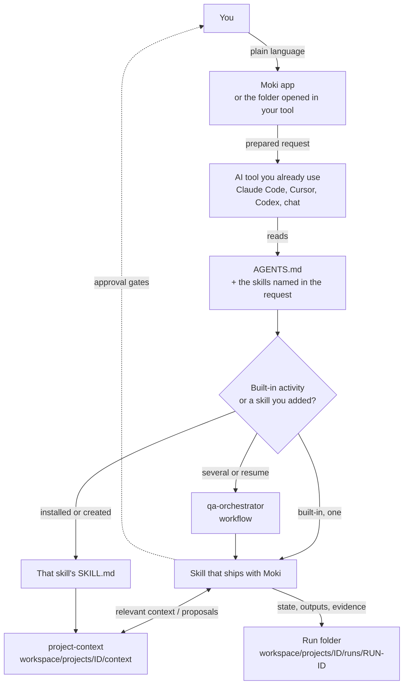
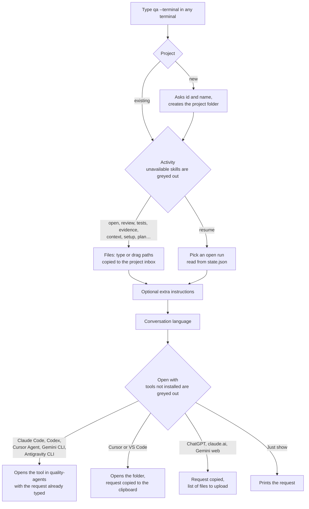
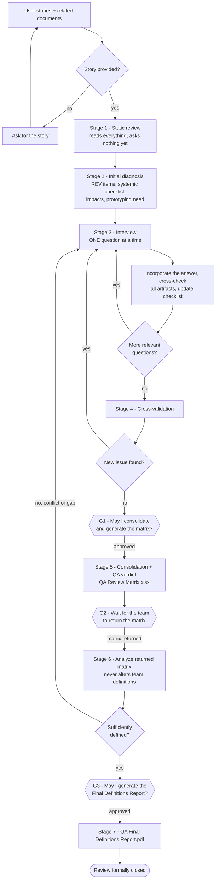
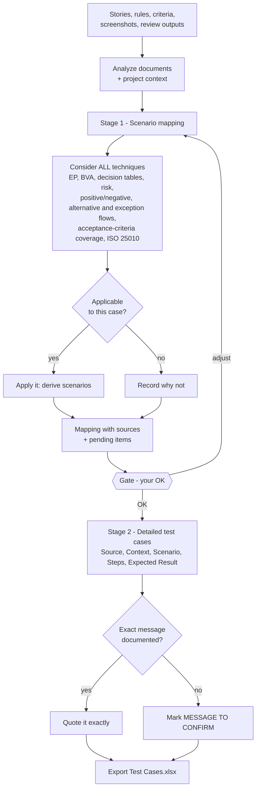
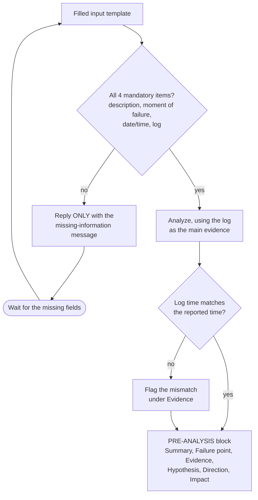
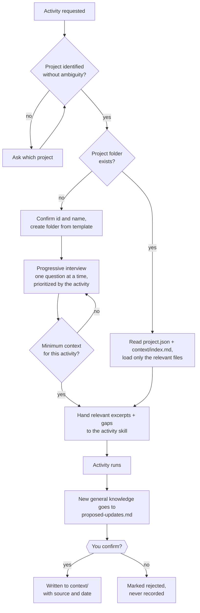
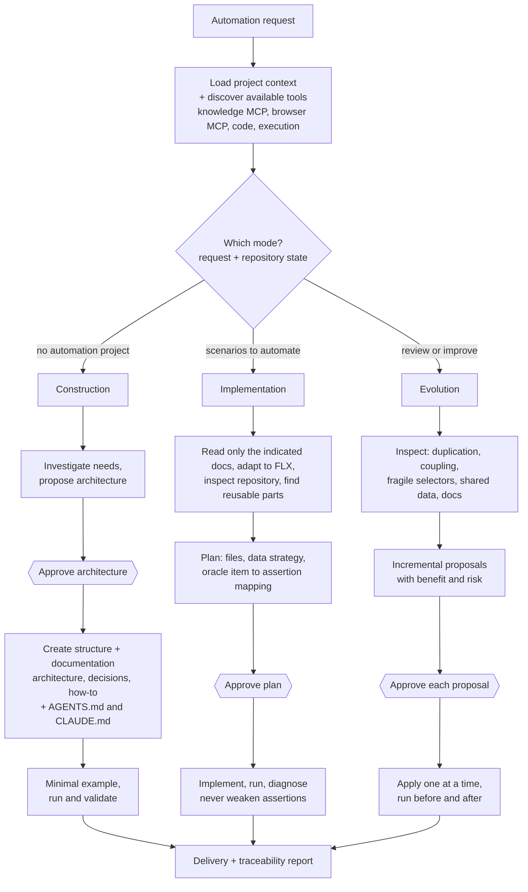
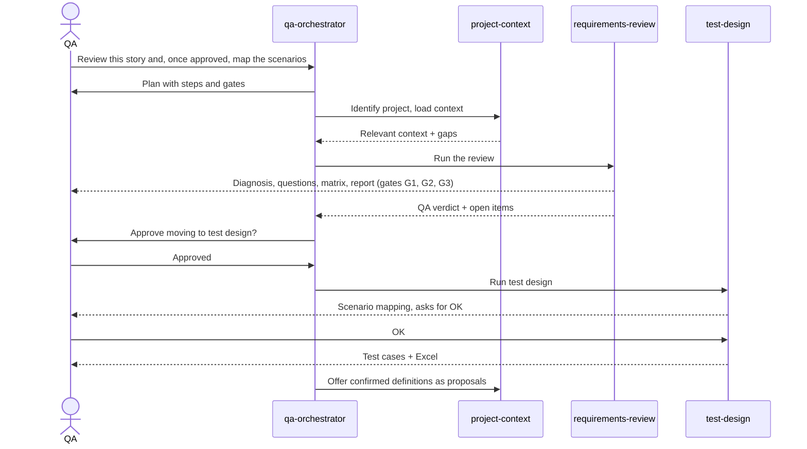
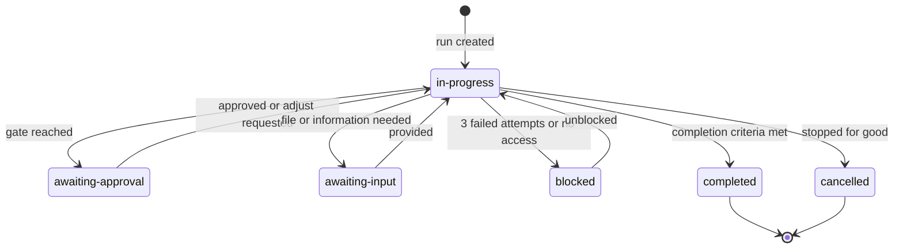
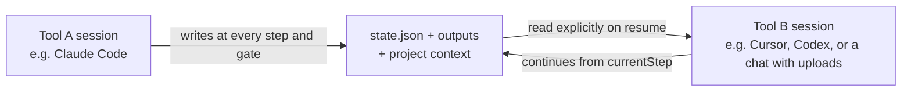

# Moki

🇧🇷 [Leia em português](README.pt-BR.md)

<p align="center"></p>

<p align="center">
  <a href="https://github.com/Orsi88/quality-agents/releases/latest"><b>⬇️ Download Moki for Windows</b></a>
  &nbsp;·&nbsp; <a href="https://github.com/Orsi88/quality-agents/releases/download/v0.2.0/Moki.Setup.0.2.0.exe">direct link (v0.2.0, .exe)</a>
  &nbsp;·&nbsp; <a href="#30-the-quickest-way-the-windows-installer">how to install</a>
</p>

A local app and a portable library of **instructions for AI agents**. Moki keeps each project on your computer and opens the AI tool you already use — Claude Code, Cursor, Codex, ChatGPT, claude.ai, Gemini or another — with the request ready. It has no AI of its own.

It started as a way to run software quality work the same way in every tool: review stories, design tests, analyze a failure, assemble evidence. That work still ships with Moki. A project can now also be anything you describe: a blank project whose context the AI plans with you, a folder you already have, and skills and agents you install or write (programming, design, security, documentation, or a procedure of your own).

This guide is for anyone using Moki. The app and the activities that ship with it need no programming: install, open a project and talk to your AI tool in plain language.

---

## Contents

1. [What it is (and what it is not)](#1-what-it-is-and-what-it-is-not)
2. [Key concepts in 2 minutes](#2-key-concepts-in-2-minutes)
3. [Install (once per computer)](#3-install-once-per-computer)
4. [Choose how you will use it](#4-choose-how-you-will-use-it)
5. [Quick start: your first activity in 10 minutes](#5-quick-start-your-first-activity-in-10-minutes)
6. [Create a project](#6-create-a-project)
7. [Skill guides, step by step](#7-skill-guides-step-by-step)
8. [Workflows: several activities in sequence](#8-workflows-several-activities-in-sequence)
9. [Stop and resume an activity](#9-stop-and-resume-an-activity)
10. [Tool-by-tool setup](#10-tool-by-tool-setup)
11. [Where every file goes](#11-where-every-file-goes)
12. [Privacy and isolation](#12-privacy-and-isolation)
13. [Command reference](#13-command-reference)
14. [Troubleshooting](#14-troubleshooting)
15. [Updating the framework](#15-updating-the-framework)
16. [Adding a new skill](#16-adding-a-new-skill)
17. [Contributing](#17-contributing)
18. [Repository map](#18-repository-map)

---

## 1. What it is (and what it is not)

**It is**

- A **desktop app** (Windows installer, or `qa` from a clone). It lists your projects, shows their files and opens your AI tool with a prepared request. There is no account and no server to deploy.
- A set of **skills**: written instructions, in the open [Agent Skills](https://agentskills.io) format — the steps, the rules, the output format and where the work must stop for your approval. Some ship with Moki. Others you install from the public [SkillMD](https://skillmd.com) registry or ask your AI tool to draft.
- **Agents**: a role that uses one or more skills, with an access level. The built-in roles cover the quality activities. You can duplicate them or create your own, for one project or for every project.
- A **project context**: the knowledge you have confirmed, in Markdown and JSON, isolated per project. A quality project starts with glossary, business rules, modules and conventions. A blank project gets its files only after you approve a plan.
- A **record of every activity**: inputs, outputs and a `state.json`, so you can stop and resume later — even in a different AI tool.

**It is not**

- Not an AI, a chatbot or a hosted service. Moki does not answer the request. The tool you choose does, and an online tool follows that provider's data policy.
- Not tied to one AI vendor.
- Not a substitute for your decision. The skills that ship with Moki stop at approval gates and wait for an explicit answer.
- Not a store for project data inside this Git repository. Projects, results, notes and installed skills for a project stay under `workspace/` on your computer (or in a folder you link). That tree is never uploaded here.

### Skills that ship with Moki

| Skill | What it does | Status |
|---|---|---|
| `requirements-review` | Reviews user stories before development: ambiguities, contradictions, gaps, rule interactions, risks. Interactive interview (one question at a time), QA Review Matrix (Excel), Final Definitions Report (PDF). Never writes test cases. | draft |
| `test-design` | Maps test scenarios, waits for your OK, then writes detailed manual test cases and exports them to Excel. | draft |
| `failure-analysis` | Short pre-analysis of an error from your description and the log, to point developers to the probable cause. | draft |
| `evidence-collection`, `evidence-sheet`, `evidence-document` | Test evidence end to end (agent `evidence-builder`): reads the work item (Azure DevOps/Jira via MCP, or pasted) and the Jam recordings, gets your approval, then builds the evidence spreadsheet (one row per test case) and the Word document with the prints, in your own models. | draft |
| `project-context` | Creates and maintains the confirmed knowledge of a project. For a blank project, interviews you and writes a plan you approve before any context file is created. | draft |
| `qa-orchestrator` | Chains activities ("review, then design the tests"), enforces approvals, resumes interrupted work. | draft |
| `automation` | Automation engineering: builds new automation projects (Playwright + TypeScript first) already documented and AI-ready, automates documented FLX scenarios in existing projects, and evolves existing projects. | pending migration |
| `documentation`, `smoke-test` | Planned for a future version. If you ask for them, the AI will tell you they are not available. | planned |

**draft** = complete and usable, still being validated across AI tools (see [docs/compatibility-tests.md](docs/compatibility-tests.md)). **pending migration** = fully defined, waiting for the team's reference material before it can run. **planned** = not available yet.

Skills you install or create are extra. They live with the project or in your user folder, and the request the app builds names them so the AI reads their `SKILL.md` when one fits. See [Skills and agents you add](#79-skills-and-agents-you-add).

---

## 2. Key concepts in 2 minutes

| Term | Meaning |
|---|---|
| **Skill** | The instructions for one activity. The AI reads them; you open a skill file only when you want to change it. |
| **Agent** | A role that does the work using one or more skills (e.g. `requirements-analyst`), with an access level. Built-in agents can be duplicated, and you can create your own — see [docs/agents.md](docs/agents.md). |
| **Project** | One body of work on this computer: a system you test, a repository you link, or a blank project you describe. Identified by a short id in lowercase with hyphens: `billing-portal`. |
| **Project context** | What the AI may treat as known: only definitions **you confirmed**. A quality project starts with glossary, rules, modules, flows, permissions, environments and conventions. A blank project proposes its own files in a plan. |
| **Run** | One execution of an activity (e.g. "review of story US-310"). Each run has an id like `20261020-0930-requirements-review-us-310` and its own folder with inputs, outputs and a `state.json` file. |
| **state.json** | The "save game" of a run: current step, completed steps, pending questions, your approvals, files produced. It is what makes resuming possible. |
| **Approval gate** | A point where the AI must stop and wait for your explicit answer before continuing (e.g. "May I generate the QA Review Matrix?"). |
| **Workspace** | The `workspace/` folder on your computer where all project data and results live. Never versioned. |

### How it all fits together



> Diagrams in this README use [Mermaid](https://mermaid.js.org). GitHub renders them automatically; in VS Code install a Mermaid preview extension to see them.

---

## 3. Install (once per computer)

### 3.0 The quickest way: the Windows installer

1. Download **Moki.Setup.0.2.0.exe** from the [Releases page](https://github.com/Orsi88/quality-agents/releases), or use the direct link above.
2. Run it. Windows may show *"Windows protected your PC"* because the installer is not digitally signed yet: click **More info → Run anyway**.
3. Choose the installation folder and finish. A **Moki** shortcut is created on the desktop and in the Start menu.

On first launch the app creates **Documents\Moki** — the framework (skills, `AGENTS.md`, templates) plus your `workspace/`, where projects and results live. Your AI tool is opened in that folder. Installing a newer version refreshes the framework files there and **never touches `workspace/`**; uninstalling the app keeps that folder too.

You still need an AI tool (Claude Code, Codex, Cursor…). Node.js is optional on this path: the installed app opens without it. It is only needed for the helper commands (Excel, Word and PDF).

Prefer the terminal, contribute to the framework, or use macOS/Linux? Follow the steps below; to build the installer for your system, see [3.7](#37-build-the-desktop-app-installer-windows-macos-linux).

### 3.1 What you need

| Software | Why | Required? |
|---|---|---|
| **Git** | To download (clone) and update the framework from this repository | Only for the clone path below. The Windows installer does not need Git. |
| **Node.js 22.18 or newer** (LTS) | From a clone: runs `qa`, builds the app and runs the helper commands (projects, runs, Excel, Word, PDF, commit checks). The installed app opens AI tools without Node.js; those helper commands still need it. | For a clone, yes. For the installer, only when you want the helper commands. |
| **Microsoft Edge or Google Chrome** | Used in the background to create PDF reports | Only for PDF generation (Edge already comes with Windows) |
| An **AI tool** | Claude Code, Cursor, Codex, claude.ai, ChatGPT, Gemini... | Yes |

### 3.2 Install Git and Node.js

**Windows**
1. Git: download from https://git-scm.com/download/win and install with the default options.
2. Node.js: download the **LTS** installer from https://nodejs.org and install with the default options.
3. Close and reopen any terminal window.

**macOS**
1. Open the **Terminal** app and type `git --version`. If Git is missing, macOS offers to install it — accept.
2. Node.js: download the **LTS** installer from https://nodejs.org and install it.

**Linux**: install `git` and `nodejs` (version 22.18+) with your distribution's package manager.

Check the installation in a terminal (Windows: **PowerShell** or **Git Bash**; macOS/Linux: **Terminal**):

```bash
git --version
node --version
npm --version
```

Each command should print a version number. `node --version` must be `v22.18` or higher.

### 3.3 Download the framework

Choose a folder for it (for example your Documents folder) and run:

```bash
git clone https://github.com/Orsi88/quality-agents.git
cd quality-agents
```

If your team uses its own fork, clone that address instead (GitHub "Code" button → HTTPS).

### 3.4 Run the one-time setup

Still inside the `quality-agents` folder:

```bash
npm run setup
```

It takes about a minute. It:

1. installs the development tools (only inside this folder),
2. builds the desktop app,
3. creates your local `workspace/` folder,
4. turns on the protection that blocks accidental commits of project data or passwords.

It ends with `Done. Start Moki with: npm run qa`. Run `npm run setup` again after each update (`git pull`).

### 3.5 Check that everything is fine

```bash
npm run check
```

Expected output ends with `Validation passed`, `Artifact check passed` and `Secret check passed`.

### 3.6 Install the `qa` command (recommended)

Still inside the `quality-agents` folder:

```bash
npm link
```

From now on you can type `qa` in **any** terminal folder to open the Moki desktop app ([section 4.1](#41-the-desktop-app-qa)). If `npm link` fails with a permission error on macOS/Linux, use `sudo npm link`, or skip it and run `npm run qa` from the `quality-agents` folder instead.

> **Windows tip:** if PowerShell says *"running scripts is disabled on this system"* when you type `npm`, use **Git Bash** instead, or type `npm.cmd` instead of `npm`, or see [Troubleshooting](#14-troubleshooting).

### 3.7 Build the desktop app installer (Windows, macOS, Linux)

Optional: for whoever publishes the installers, or to get the app on macOS/Linux as a standalone program. After [3.4](#34-run-the-one-time-setup), run the command for your system inside the `quality-agents` folder. **Build each installer on the system it is for** (a macOS installer can only be built on a Mac). The files are written to `release/`.

| System | Command | Result in `release/` |
|---|---|---|
| Windows 10/11 (x64) | `npm run dist:win` | `Moki Setup <version>.exe` |
| macOS (Intel or Apple Silicon) | `npm run dist:mac` | `Moki-<version>.dmg` (`-arm64` in the name on Apple Silicon) |
| Linux (x64) | `npm run dist:linux` | `Moki-<version>.AppImage`, plus `.deb` and `.rpm` |

The installers are not code-signed yet: Windows shows the SmartScreen warning described in [3.0](#30-the-quickest-way-the-windows-installer); macOS blocks the first launch — right-click the app → **Open**, or **System Settings → Privacy & Security → Open Anyway**. On every system the first launch creates **Documents/Moki**, as in 3.0.

#### Linux: distributions and versions

The Linux build is a single `.AppImage`: one file that runs without installation on any x64 distribution with **glibc 2.25 or newer** and a graphical desktop (GTK 3). Building it needs only Git and Node.js 22.18+ — no compiler or extra packages.

| Distribution | Versions | FUSE 2 package the AppImage needs |
|---|---|---|
| Ubuntu | 22.04 LTS | `sudo apt install libfuse2` |
| Ubuntu | 24.04 LTS or newer | `sudo apt install libfuse2t64` (see the AppArmor note below) |
| Debian | 12 or newer | `sudo apt install libfuse2` (Debian 13: `libfuse2t64`) |
| Linux Mint / Pop!_OS / elementary OS | Mint 21+, Pop!_OS 22.04+, elementary OS 7+ | same package as the Ubuntu version they are based on |
| Fedora | 42 or newer | `sudo dnf install fuse-libs` |
| RHEL / Rocky Linux / AlmaLinux | 9 or newer | `sudo dnf install fuse-libs` |
| openSUSE | Leap 15.6, Tumbleweed | `sudo zypper install libfuse2` |
| Arch / Manjaro | rolling | `sudo pacman -S fuse2` |

To run it: `chmod +x "Moki-<version>.AppImage"`, then double-click it or start it from a terminal.

- **No menu entry** is created. Keep the file in a fixed folder (e.g. `~/Applications`); tools such as AppImageLauncher or Gear Lever can add it to the menu.
- **Ubuntu 24.04 or newer:** AppArmor blocks the sandbox Electron apps use, and the AppImage may close right away with a *"sandbox"* error. Start it with `"./Moki-<version>.AppImage" --no-sandbox` (this turns off Chromium's sandbox for this app).
- **ARM64:** build on an ARM64 machine with `npm run app:build` then `npx electron-builder --linux AppImage --arm64`.

---

## 4. Choose how you will use it

| If you use... | Mode | What changes |
|---|---|---|
| **Claude Code, Cursor or Codex** (tools that open a folder on your computer) | **Agent mode** — recommended | The AI reads the skills, your project context and your files directly, saves results in the right folders, and can create Excel/PDF. You only talk to it. |
| **claude.ai, ChatGPT, Gemini** (browser/desktop chat) | **Chat mode** | You upload the skills once, and in each activity you upload the needed files and save what the AI produces. See [10.4](#104-claudeai-chatgpt-gemini-and-other-chat-tools). |

And three ways to work, whatever the tool:

| Way | For whom |
|---|---|
| **The desktop app — `qa`**: a start screen with your projects and loose notes, then an Obsidian-like workspace to browse, read and edit the project files and **open the project in your AI tool with the request ready**. | Everyone — the easiest way |
| **The terminal menu — `qa --terminal`**: project → activity → files → AI tool; prepares everything and opens your AI tool with the request ready. | Anyone who does not want to deal with folders and prompts |
| **Open the `quality-agents` folder** in your AI tool and ask in plain language | People comfortable with the AI tool. `AGENTS.md` routes that conversation through the built-in skills. A skill you installed is named when the app or `qa --terminal` builds the request; in a session you opened yourself, name that skill. |

### 4.1 The desktop app (`qa`)

Type `qa`, or use the desktop shortcut from the installer. Moki opens in its own window — no browser, no server.

**Start screen** — your projects on the left. Pin one to keep it at the top. Hide one and its files stay on this computer; it moves under **Hidden**, and the eye button shows it again. Create a project by typing its name. That form still says "one project per system you test"; a blank project and a linked folder use the same form. The last project you used reopens automatically. The corner chooses **English or Portuguese** and a **light or dark** theme; the first launch asks for both.

**Workspace** (like Obsidian):

| Area | What it does |
|---|---|
| **Left ribbon** | All projects · Open in your AI tool · New terminal · Open the project folder · Link a folder · Settings · Refresh · Show/hide the side panel |
| **File tree** | *Context* (confirmed knowledge), *Inbox* (files you give the AI), *Activities* (each run, with date and a status dot), *Notes*, proposed updates and activity log |
| **Documents in tabs** | Markdown is shown formatted; **Ctrl+E** switches to editing, **Ctrl+S** saves, **Ctrl+W** closes. Word files show their text; JSON, text and images are previewed; Excel and PDF open in their own program |
| **Side panel** | For an activity: status, current step, pending items, approvals and the files produced, plus *Continue in your AI tool*. Otherwise: project overview, **agents enabled in this project** (checkboxes), open activities, and **Graph view** (the tab says it is under construction) |
| **Open in your AI tool** | Choose the activity, optionally **who should do it** (an agent), the inbox files, add a note, pick the tool: Claude Code, Codex, Gemini CLI, Antigravity CLI or Cursor Agent open in a terminal tab of the app; Cursor or VS Code open the folder with the request copied; ChatGPT / claude.ai / Gemini web, and *Just show the request*, leave the text on the review step ready to copy. The request names the linked folder and the skills and agents installed for that project. If opening is still running after about 20 seconds, the wizard says the request is taking too long instead of staying on "Opening…". |
| **Settings** | The gear on the ribbon. Three tabs: **Agents**, **Skills** and **Documents**. |
| **Agents** | Agents by category, with their role, skills and access. **Duplicate** a built-in agent into `workspace/library/agents/`, then **Edit** and **Save** it (checked before saving) or delete it. **Create agent** writes a new one for this project (`<linked folder>/.claude/agents/`, or `workspace/projects/<id>/agents/` when nothing is linked) or for every project (`~/.claude/agents/`). |
| **Skills** | **Already installed** (each skill shows where it lives), **Native and created** (the skills that come with Moki and the ones you created — this list does not create skills) and **Add a skill**. Adding a skill searches the public SkillMD registry (programming, design, QA and testing, security, docs and writing), or **Create skill** describes one for your AI tool to draft. A skill for this project is stored in `<linked folder>/.claude/skills/` or `workspace/projects/<id>/skills/`. A skill for every project is stored in `~/.claude/skills/` and `~/.agents/skills/`. |
| **Documents** | How the PDF, Word and Excel files that activities and agents generate look: font, colours, header, footer, logo and a text watermark, with a live page preview. One style for every project, or a project's own. The logo (PNG, JPEG, WebP or GIF) and the watermark go to PDF and Word; Excel keeps the header texts when printing. **Save** applies to new files. |

- **Drop files**: drop files onto the workspace and they are copied into that project's inbox. Folders are skipped. Up to 40 files, each up to 200 MB. The same hide action as the start screen is on the file tree (*Hide from Moki*).
- **Live**: files the AI writes appear in the tree as soon as they are saved.
- **Word files**: `.docx` files are converted to text automatically so any AI can read them.
- **Notes**: project notes are Markdown files under the project's `notes/` folder and open in their own window. Loose notes on the start screen stay in the app until you send one to a project.
- **Sessions the app opens**: Claude Code and Codex started from Moki also load the plugins in `adapters/app-plugins/` (ponytail, and rtk when that command is installed). The same tool started outside the app does not load them. A plugin whose requirement is missing is skipped.
- **Local and private**: project data comes from the files in `workspace/` and from a folder you link. No account, no hosting, no database.
- How it is built (for contributors): [docs/desktop-app.md](docs/desktop-app.md).

Everything below describes **agent mode** first. Chat-mode differences are noted where relevant.

### 4.2 The terminal menu (`qa --terminal`)

`qa --terminal` is a small menu that runs in your terminal. **It has no AI of its own and calls no online service**: it only copies your files into the right project folder, writes the request for you, and opens the AI tool you already use.



Example session. The question *Which project (system under test)?* is the menu's own label; a blank project or a project with a linked folder uses the same question.

Use **↑/↓** to move, **Enter** to select (or type the option number), **Ctrl+C** to cancel. Each answer collapses after you choose it, so the screen stays clean. While a question is open it looks like this:

```text
┌  Moki
│  Prepares your request and opens the AI tool you use. Your data stays in workspace/.
│
◇  Which project (system under test)?
│  billing-portal
│
◆  What do you want to do?
│  ● Just open the project  loads the context and asks what you need
│  ○ Review user stories  ambiguities, gaps, interview, matrix, report
│  ○ Design tests
│  ○ Review, then design tests
│  ○ Failure pre-analysis
│  ○ Build test evidence  work item + Jam recordings, then spreadsheet and Word document
│  ○ Project context
│  ○ Prepare the project  adapts the context to the project description
│  ○ Plan the project with the AI  interview, then a plan you review in the app
│  ○ Automation  (not available yet: pending-migration)
│  ○ Resume a run  (no open runs)
└  ↑/↓ move · Enter select · Ctrl+C cancel
```

A complete session, at the end:

```text
┌  Moki
│
◇  Which project (system under test)?
│  billing-portal
│
◇  What do you want to do?
│  Review user stories
│
◇  Input file
│  C:\Users\me\Downloads\US-310.docx
│
│  ✔ File 1 → workspace/projects/billing-portal/inbox/US-310.docx
◇  Anything else the AI should know?
│  focus on permissions
│
◇  Conversation language
│  Portuguese (pt-BR)
│
◇  Open with
│  Claude Code
│
◇  Summary
│  Project   billing-portal
│  Activity  Review user stories
│  Files     workspace/projects/billing-portal/inbox/US-310.docx
│  Note      focus on permissions
│  Language  Portuguese (pt-BR)
│  Tool      Claude Code
│
◇  Open Claude Code now?
│  Yes
│
│  Request (also saved in workspace/temporary/last-prompt.txt):
│  Follow AGENTS.md. Project: billing-portal. Use the requirements-review skill to review the user stories in: ...
└  Opening Claude Code …
```

In terminals without color/arrow support (or when input is piped), `qa` automatically falls back to numbered menus. You can force it with `qa --plain`.

From there you continue the conversation in the AI tool as usual. `qa` remembers your last project, language and tool (stored in `workspace/`, never versioned). The last request is also saved in `workspace/temporary/last-prompt.txt`.

**Shortcut without menus** (all options on one line):

```bash
qa --project billing-portal --activity review --file ~/Downloads/US-310.docx --tool claude --lang "Portuguese (pt-BR)"
qa --project billing-portal --activity resume --run 20261020-0930-requirements-review-us-310 --tool codex
qa --help
```

| Option | Values |
|---|---|
| `--activity` | `open`, `review`, `tests`, `review-then-tests`, `failure`, `evidence`, `context`, `setup`, `plan`, `automation`, `resume` |
| `--tool` | `claude`, `codex`, `cursor-agent`, `gemini`, `antigravity`, `cursor`, `vscode`, `chat`, `print` |
| `--file` | Repeat for several files |
| `--run` | Run id, for `resume` |
| `--note` | Extra instructions |
| `--lang` | Conversation language, e.g. `English`, `"Portuguese (pt-BR)"` |

---

## 5. Quick start: your first activity in 10 minutes

This walkthrough uses one built-in quality activity and the fictional system **Acme Library** in [examples/](examples/README.md). The same steps — project, request, run folder — are how every activity is recorded. A blank project or a skill you installed follows its own instructions once the request names it.

> **Shortcut:** if you installed the `qa` command ([3.6](#36-install-the-qa-command-recommended)), type `qa --terminal` and follow the menu — it does steps 1 and 2 for you.

**Step 1 — Open the folder in your AI tool**
- Claude Code: in a terminal, `cd quality-agents` then `claude` (or open the folder in the VS Code extension / desktop app).
- Cursor: *File → Open Folder* → select `quality-agents`.
- Codex: in a terminal, `cd quality-agents` then `codex`.

**Step 2 — Ask for an activity in plain language**

Copy the example story into the project inbox (or simply ask the AI to read it from `examples/`), then type:

> Create the project Acme Library and run a failure analysis with the file examples/failure-analysis/complete-report.txt

**Step 3 — Watch what happens**

1. The AI confirms the project id (`acme-library`) and name, and creates `workspace/projects/acme-library/`.
2. It may ask one or two context questions — answer briefly or say "skip for now".
3. It creates a run, analyzes the report and answers with a block starting with `[PRE-ANALYSIS]` (or `[PRÉ-ANÁLISE]` if the project's deliverable language is `pt-BR`).
4. The result is saved in `workspace/projects/acme-library/runs/<run-id>/outputs/pre-analysis.txt`.

**Step 4 — Check the result objectively (optional)**

```bash
npm run check-output -- pre-analysis workspace/projects/acme-library/runs/<run-id>/outputs/pre-analysis.txt
```

You just used the framework. The next sections explain each part in detail.

---

## 6. Create a project

A project is one body of work on this computer. It has a short id (`billing-portal`) and a folder under `workspace/projects/`. Three ways to start:

| Start | What you get |
|---|---|
| **QA context files** (the default) | The quality folder in [6.3](#63-what-is-inside-a-project-folder): glossary, rules, modules, flows, permissions and the rest. Use this for a system you test. |
| **A blank project** | No `context/` yet. You describe the goal; the AI interviews you and writes a plan. Context files are created only after you approve it. In the app, choose *A blank project*. From a terminal: `npm run new-project -- <id> "<Name>" --blank`. |
| **An existing folder** | On the start screen, *Open a project* picks a folder. The project is named after it (you can edit the name), linked, and opened in *Set up &lt;name&gt;*. The folder's AI settings (`.claude`, `.agents`, `.codex`, `.gemini`, `.cursor`, `CLAUDE.md`, `AGENTS.md`, `GEMINI.md`) are copied to `.moki-backup/link-<date>/` inside that folder. Nothing else in the folder changes. Requests opened from the project name that folder. |

Linking a folder from a project that already exists is the link button on the ribbon. Installing a skill or agent into that folder's `.claude` asks you to confirm, backs up `.claude` first, and is refused when that repository's entry says `writeAllowed: false`.

### 6.1 Automatic (recommended)

Just mention the project when asking for an activity:

> Review this story for the **Billing Portal**.

If the project does not exist yet, the `project-context` skill:

1. Proposes an id (`billing-portal`) and asks you to confirm id and display name.
2. Creates the folder from the template.
3. Starts a **progressive interview**: one question at a time, starting with what the requested activity needs (for a review: what the system does, which modules are affected, whether it has multiple companies/tenants, multiple languages, configurable parameters, e-mails, audit trail...).
4. Stops as soon as the activity has the minimum it needs and tells you what is still missing. The rest is collected over time.

Tips for the interview:
- Answer "I don't know" freely — it is recorded as *unknown*, which is different from "not applicable".
- If you have documentation (functional manual, rule catalog), put it in the project's `inbox/` folder first. The AI reads it, proposes what it found, and asks you to confirm in batches instead of asking everything.
- The AI never asks for passwords. Never type one into the context.

### 6.2 Manual

```bash
npm run new-project -- billing-portal "Billing Portal"
```

Then fill in `workspace/projects/billing-portal/project.json` (or let the AI do it in the next activity).

### 6.3 What is inside a project folder

A project that starts with the QA context files looks like this. A blank project has the same `project.json`, `proposed-updates.md`, `activity-log.md`, `inbox/` and `runs/`, plus `plan.json` once the interview has a plan, and no `context/` until you approve that plan. `project.json` records `"starter": "qa"` or `"starter": "blank"`.

```text
workspace/projects/billing-portal/
├── project.json            # name, environments, repositories, tools, constraints, data-sharing policy
├── context/                # CONFIRMED knowledge only
│   ├── index.md            # list of context files (read first by the AI)
│   ├── overview.md         # purpose, users, scope
│   ├── glossary.md         # domain terms
│   ├── modules.md          # modules and screens
│   ├── actors-and-permissions.md
│   ├── business-rules.md   # rules with official ids and sources
│   ├── flows.md            # flows, states, transitions
│   ├── system-characteristics.md   # multi-company, languages, parameters, e-mails, audit... + team-specific checks
│   ├── integrations.md
│   ├── environments-and-tools.md   # URLs, repositories, where logs are (never credentials)
│   └── conventions.md      # deliverable language, id formats, templates, automation architecture
├── proposed-updates.md     # knowledge found during activities, waiting for your confirmation
├── activity-log.md         # one line per activity
├── inbox/                  # put your input files here
├── runs/                   # one folder per activity
└── temporary/
```

### 6.4 How the context grows

During any activity the AI may discover something that looks like a general rule of the system (for example, "only supervisors approve extensions"). It does **not** write it into `context/` directly. It adds it to `proposed-updates.md` and, at the end of the activity, asks you:

> Is this a general rule of the system, or specific to this story?

Only after your confirmation is it moved into the right `context/` file, with source and date. You can also ask at any time:

> Show me the pending context updates for Billing Portal.
> Add to the Billing Portal glossary: "Dunning" means the automated collection e-mail sequence.
> What do you know about Billing Portal permissions?

### 6.5 Team-specific checks

If your team always checks something particular to your system (for example a feature called "E-mail Accumulator"), record it in `context/system-characteristics.md` under **Project-specific review checks**. The review and test-design skills evaluate those checks every time, using your team's names.

### 6.6 Deliverable language

Deliverables are in **English** by default. To change it for one project, set in `workspace/projects/<project-id>/project.json`:

```json
"deliverableLanguage": "pt-BR"
```

Order of precedence: what you ask for in the activity → the project's `deliverableLanguage` → English. The conversation always follows the language you write in, and messages quoted from your documents stay in their original language. Available labels: `en` and `pt-BR` (the team's original process).

### 6.7 Sharing a project's context with your team (optional)

The context is plain Markdown and JSON. To share it, version **that project folder** in a separate **private** Git repository:

```bash
cd workspace/projects/billing-portal
git init
git add .
git commit -m "Billing Portal context"
git remote add origin <your-private-repository-url>
git push -u origin main
```

The project folder already contains a `.gitignore` that keeps `runs/`, `inbox/` and `temporary/` out, so activity results stay private and unversioned. Teammates clone that private repository into their own `workspace/projects/billing-portal/`. Never put project context in the public Moki repository.

---

## 7. Skill guides, step by step

The guides in this section are the skills that **ship with Moki**. A skill you install or create follows its own `SKILL.md`; [7.9](#79-skills-and-agents-you-add) says where it lives and how a request names it.

The built-in skills share the same habits:

- The AI **identifies the project first** and loads only the context the activity needs.
- It creates a **run** and saves everything under `workspace/projects/<project-id>/runs/<run-id>/`.
- It **stops at approval gates** and waits. Words like "ok", "approved", "go ahead", "pode seguir" approve the gate in question; anything else is not approval.
- It **never invents** requirements, rules, messages or data — missing information becomes a pending item.
- It **talks to you in your language**, but **deliverables are in English by default** (the framework is international). To get deliverables in another language, set it per project — `"deliverableLanguage": "pt-BR"` in `project.json` — or ask for it in the activity ("generate the matrix in Portuguese"). Messages quoted from your documents are never translated. See [6.6](#66-deliverable-language).

### 7.1 Requirements review (`requirements-review`)

**When:** before development and before test design, to make sure a user story is clear, consistent and testable.

**You provide:** one or more user stories, plus anything related — business rules, acceptance criteria, screenshots, prototypes, flows. Put the files in the project's `inbox/`.

**How to start:**

> Review the user story workspace/projects/billing-portal/inbox/us-310.md of project billing-portal.

(In Claude Code you can also type `/requirements-review`. You can write the request in any language.)

**How it works:**



Hexagons are approval gates: the AI stops and waits for you.

**What happens, stage by stage:**

| Stage | What the AI does | What you do |
|---|---|---|
| 1. Static review | Reads everything before asking anything | Wait |
| 2. Initial diagnosis | Presents: stories analyzed, understanding, problems (`[REV-001]`, `[REV-002]`...), systemic checklist, apparent impacts, prototyping need. No verdict yet. | Read it |
| 3. Interview | Asks **one question at a time**, starting with contradictions, then ambiguities, fundamental rules, rule interactions, permissions... | Answer each question. Be specific: "whoever has permission" will be challenged ("which permission?"). If you don't know, say so. If you have a screenshot or prototype, attach it. |
| 4. Cross-validation | Re-checks everything with your answers; returns to the interview if something new appears | Answer remaining questions |
| **Gate G1** | Asks: *"I have completed the cross-validation and found no other relevant issues. May I consolidate the review and generate the QA Review Matrix?"* | Answer "yes" (or ask for changes) |
| 5. Consolidation | Summary, definitions, impacts, changes needed in the stories, pending items, **QA verdict** (READY / READY WITH CAVEATS / NOT READY), and the file **QA Review Matrix.xlsx** with 7 sheets | Download/open the Excel |
| **Gate G2** | Waits for the matrix to come back | Share the Excel with your team (PO, dev, analyst). Fill in answers for pending/blocked points. Save it in the run's `inputs/` folder or the project's `inbox/`, and tell the AI: "Here is the returned matrix." |
| 6. Returned matrix analysis | Reads all sheets, finds what changed, checks for new contradictions. Never alters your team's definitions. Returns to one-question interview if needed. | Answer if asked |
| **Gate G3** | Asks: *"The matrix is sufficiently consolidated for formalization. May I generate the Final Definitions Report in PDF?"* | Answer "yes" |
| 7. Final report | Generates **QA Final Definitions Report.pdf**: a consolidated specification (not meeting minutes) | Share with the team |

The review is formally closed only after the PDF. You can stop at any point and resume later ([section 9](#9-stop-and-resume-an-activity)).

**Results** (in `workspace/projects/<project-id>/runs/<run-id>/outputs/`): `review-matrix.json`, `QA Review Matrix.xlsx`, `final-report.md`, `QA Final Definitions Report.pdf`. With `deliverableLanguage: pt-BR` you get the team's original labels and names: *Matriz de Revisão QA.xlsx*, *Relatório Final de Definições QA.pdf*, verdicts APTA / APTA COM RESSALVAS / NÃO APTA.

**Check the matrix objectively:**

```bash
npm run check-output -- review-matrix workspace/projects/<project-id>/runs/<run-id>/outputs/review-matrix.json
```

### 7.2 Test design (`test-design`)

**When:** you need manual test cases for a story or change — ideally after the review.

**You provide:** user stories, business rules, acceptance criteria, screenshots, tables, flowcharts, notes. If a review was done, the AI uses its final definitions.

**How to start:**

> Map the test scenarios for workspace/projects/billing-portal/inbox/us-310.md

**How it works:**



**What happens:**

1. **Stage 1 — Scenario mapping.** The AI lists scenarios grouped by story/rule, each with its origin:

   ```text
   ### 🔸 US:310 / RN.004 – Late fee calculation
   🔹 Scenario: Fee applied on the first day after due date – (Source: US:310 / RN.004)
   🔹 Scenario: No fee on the due date itself – (Source: Acceptance Criterion)
   ```

   It also lists which test techniques it applied (equivalence partitioning, boundary values, decision tables, risk, positive/negative, alternative/exception flows, acceptance-criteria coverage, ISO 25010) and why any did not apply, plus pending items (e.g. a message whose exact text is not documented).
2. **Gate — your OK.** Review the mapping. Ask for additions/removals, or say "OK, detail the test cases."
3. **Stage 2 — Detailed test cases** with the columns **Source | Context | Scenario | Steps | Expected Result**, concrete values (e.g. `17`, `18`, `19` around a limit of 18), exact messages in quotes when documented (kept in their original language), and `[MESSAGE TO CONFIRM]` when the text is not documented.
4. **Export** to `Test Cases.xlsx` (`Casos de Teste.xlsx` with pt-BR columns Origem | Contexto | Cenário | Passo a Passo | Resultado Esperado when the project's deliverable language is pt-BR).

**Check the test cases objectively** (verifies required fields, numbered steps, duplicates, and that every quoted message really exists in your documents):

```bash
npm run check-output -- test-cases workspace/projects/<project-id>/runs/<run-id>/outputs/test-cases.json --source workspace/projects/<project-id>/inbox/us-310.md
```

If your project uses a different test-case template, describe it in the project's `context/conventions.md`.

### 7.3 Failure analysis (`failure-analysis`)

**When:** you found an error and want to give developers a quick, focused direction.

**You provide** — copy the [input template](skills/failure-analysis/references/input-template.md) and fill it in:

| Field | Mandatory |
|---|---|
| Item description: flow, action executed, expected result, obtained result | Yes |
| Moment of failure (which step) | Yes |
| Date/time of the evidence (approximate) | Yes |
| Log: relevant excerpt with the error and stack trace | Yes |
| Observations: does it always happen? variations? | No |

**How to start:** paste the filled template (or save it in `inbox/` and point to it).

**How it works:**



**What happens:**

- If any mandatory field is missing, the AI does **not** analyze. It answers only:

  ```text
  To start the pre-analysis, I need the following information:
  - [only the missing fields]
  ```

  (in your language — e.g. "Para iniciar a pré-análise, preciso das seguintes informações:")

- With everything provided, it returns a short notepad-style block:

  ```text
  [PRE-ANALYSIS]

  Summary:
  - ...
  Failure point:
  - ...
  Evidence:
  - ...
  Hypothesis:
  - ... (always as a probability, never as certainty)
  Direction:
  - ...
  Impact:
  - ...
  ```

  (pt-BR deliverables use the original labels: [PRÉ-ANÁLISE], Resumo, Ponto da falha, Evidência, Hipótese, Direcionamento, Impacto.)

Copy it into the defect or send it to the developer. Tip: record where your system's logs are in the project's `context/environments-and-tools.md` so the AI can point developers to the right place.

### 7.4 Project context (`project-context`)

Used automatically at the start of every activity.



Projects never mix: the AI reads and writes only inside the active project's folder.

You can also call it directly:

| You want to... | Say |
|---|---|
| See what is known | "What do you know about Billing Portal?" |
| Complete the onboarding | "Continue the Billing Portal onboarding." |
| Add a definition | "Add to Billing Portal business rules: RN.012 — ..." |
| Review pending proposals | "Show pending context updates for Billing Portal." |
| Fix a definition | "Change the Billing Portal glossary entry for 'Dunning' to ..." (the AI shows the old and new text and asks for confirmation) |

### 7.5 Orchestrator (`qa-orchestrator`)

Used when you ask for more than one activity, when you want to resume, or when it is not clear which skill applies. See [section 8](#8-workflows-several-activities-in-sequence).

### 7.6 Automation (`automation`) — pending migration

Defined, but not runnable until the team's reference material is migrated (reference automation project, FLX scenario template, reference implementation plan). Until then the AI explains this and stops. What it will do:

| Mode | You ask | It delivers |
|---|---|---|
| **Construction** | "Create an automation project for Billing Portal" | Architecture proposal for your approval → project structure in your automation repository → **documentation of the architecture and of how/why it was built** (`docs/architecture.md`, `docs/decisions.md`, `docs/how-to.md`) → **AI guidance files** (`AGENTS.md`, `CLAUDE.md`) so anyone can keep working on that project directly with any AI tool → minimal example test, validated by running it |
| **Implementation** | "Automate scenarios FLX-012 and FLX-013 from page X of our wiki" | Reads only the indicated documentation (via MCP when available) → implementation plan with oracle → assertion mapping for your approval → code reusing existing components → execution with real results → delivery and traceability report |
| **Evolution** | "Review our automation project" / "why are these tests flaky?" | Evidence-based findings (duplication, coupling, fragile selectors, shared data, diagnostics, missing docs) → incremental proposals with benefit and risk, one approval each → applied and verified one at a time |



Rules it always follows: plan and approval before changing code; never weakens assertions to make tests pass; expected behavior comes from documentation, not from what the screen shows; test code lives only in your automation repository, never in Moki. Configure where your documentation lives in `project.json` → `knowledgeSources`.

### 7.7 Planned skills

`documentation` and `smoke-test` are not available yet. If you ask for them, the AI explains this and stops — it will not improvise.

### 7.8 Test evidence (`evidence-collection`, `evidence-sheet`, `evidence-document`)

**When:** a test was already executed and you want the evidence assembled. This does not design tests and does not decide a status on its own.

**You provide:** the source item (Azure DevOps, Jira or similar, via MCP when that is configured, or pasted), who ran it and when, the environment, the actual result and status of each test case (Passed, Failed, Blocked, Not run), and at least one piece of proof per executed case — a Jam link or a print. Optional: your own `.xlsx` and `.docx` models.

**How to start:** in the app or `qa --terminal`, choose **Build test evidence**. That starts the `test-evidence` workflow (agent `evidence-builder`).

**How it works:**

1. `evidence-collection` reads the item and the recordings, associates prints with a case and a step, and writes `outputs/evidence.json`. A status inferred from a recording is marked `proposed`. If something mandatory is missing, it asks only for that and stops.
2. It shows a summary and **stops for your approval**. It does not invent results, statuses or ids.
3. After you approve, `evidence-sheet` fills the spreadsheet (one row per test case, in your model or the default) and `evidence-document` builds the Word document with the images, keeping your model's styles, header, footer and logo when you provided one.

### 7.9 Skills and agents you add

Settings (the gear) is where this happens.

- **Add a skill** searches the public SkillMD registry, or describes a skill for your AI tool to draft. Preset searches cover programming, design, QA and testing, security, and docs and writing. Each registry install shows the audit and checks every file's sha256. Third-party skills are their author's instructions.
- **This project** stores them in `<linked folder>/.claude/skills/` or, with no linked folder, `workspace/projects/<id>/skills/`. **All projects** stores them in `~/.claude/skills/` and `~/.agents/skills/`. A project can also link global skills by name (`linkedSkills` in `project.json`) without copying them.
- **Create agent** does the same split: `<linked folder>/.claude/agents/` or `workspace/projects/<id>/agents/`, or `~/.claude/agents/` for every project. Duplicating a built-in agent still writes `workspace/library/agents/`.
- The request Moki builds names those skills and agents and tells the AI to read the matching `SKILL.md` or agent file when it fits the task. Moki does not run the skill itself. Installing into a linked folder's `.claude` asks you to confirm and backs up that folder first.

A blank project's **Plan the project with the AI** activity (`--activity plan`) interviews you one question at a time, recommends only skills and agents that are already available, and writes `proposed-updates.md` plus `plan.json`. You review the plan in the app. Context files are created only after `"approved": true`.

---

## 8. Workflows: several activities in sequence

Describe the chain in one sentence:

> Review this story, identify the gaps and, once approved, map the test scenarios.

The orchestrator recognizes the workflow, shows you the plan with its gates, and runs:

```text
project-context → requirements-review (with its gates G1, G2, G3) → YOUR APPROVAL → test-design (mapping → YOUR OK → test cases)
```



Rules:
- It never starts a step that depends on approval before you approve.
- At the review → test-design gate it shows the QA verdict and open items. If the verdict is NOT READY, it recommends not proceeding; it proceeds only if you explicitly decide so, and records your reason.

Available workflows:

| Workflow | Use when |
|---|---|
| [requirements-to-tests](skills/qa-orchestrator/references/workflows/requirements-to-tests.md) | Review a story, then design its tests |
| [failure-investigation](skills/qa-orchestrator/references/workflows/failure-investigation.md) | Pre-analyze a failure |
| [test-evidence](skills/qa-orchestrator/references/workflows/test-evidence.md) | Assemble evidence of an executed test, then the spreadsheet and the Word document |
| [quality-lifecycle](skills/qa-orchestrator/references/workflows/quality-lifecycle.md) | Full cycle for a change (steps for planned skills are skipped for now) |

You can also ask for a custom sequence; the orchestrator shows it to you and asks for approval before starting.

---

## 9. Stop and resume an activity

You can stop at any moment — close the session, go home, switch tools. The AI keeps `state.json` updated at every step and every gate.

**See your activities:**

```bash
npm run runs -- billing-portal
```

```text
billing-portal  (2 runs)
  20261020-0930-requirements-review-us-310  status=awaiting-approval  step=cross-validation  pending=2  approvals=0
  20261021-1400-test-design-us-310          status=in-progress        step=mapping           pending=1  approvals=0
```

`status` tells you what the run is waiting for: `awaiting-approval` (your answer to a gate), `awaiting-input` (a file or information, e.g. the returned matrix), `blocked`, `in-progress`, `completed`, `cancelled`.

**Resume** — in the same tool or a different one:

> Resume run 20261020-0930-requirements-review-us-310 of billing-portal.

or simply:

> Continue the US-310 review of Billing Portal.

The AI reads `state.json`, reloads only the context needed, summarizes where you stopped (current step, pending items, last approval) and continues — without redoing finished steps.

**Life cycle of a run** (the `status` in `state.json`):



**How resuming works across tools:**



**Important:** AI tools do not share memory with each other. Resuming works because the AI **reads the files**. In chat tools, upload the run's `state.json` and the relevant context files, then ask to resume.

---

## 10. Tool-by-tool setup

### 10.1 Claude Code

1. Open the `quality-agents` folder: `cd quality-agents` then `claude`, or open it in the VS Code / JetBrains extension or the desktop app.
2. Everything loads automatically: `CLAUDE.md` (which includes `AGENTS.md`) and all skills from `.claude/skills/`.
3. Ask in plain language, or invoke a skill directly: `/requirements-review`, `/test-design`, `/failure-analysis`, `/project-context`, `/qa-orchestrator`.
4. To work with your system's code repository at the same time, add it as an extra folder: `claude --add-dir ../billing-portal-repo` (or `/add-dir ../billing-portal-repo` inside a session).

More: [adapters/claude-code.md](adapters/claude-code.md).

### 10.2 Cursor

1. *File → Open Folder* → `quality-agents`.
2. Cursor reads `AGENTS.md` and the skills automatically.
3. Use the Agent chat in plain language.
4. To include your system's repository: *File → Add Folder to Workspace*.
5. Known point to verify: Cursor may list each skill twice (it reads both `.agents/skills/` and `.claude/skills/`); they are identical.

More: [adapters/cursor/README.md](adapters/cursor/README.md).

### 10.3 OpenAI Codex (CLI / IDE / app)

1. `cd quality-agents` then `codex` (or open the folder in the Codex IDE extension/app).
2. Codex reads `AGENTS.md` and the skills in `.agents/skills/` automatically.
3. Ask in plain language, or mention the skill by name.
4. If Codex's sandbox asks permission to run a command (e.g. `npm run xlsx`), approve it.

More: [adapters/codex.md](adapters/codex.md).

### 10.4 claude.ai, ChatGPT, Gemini and other chat tools

Chat tools cannot open folders on your computer, so you prepare a package once and then exchange files manually.

**Once (per framework version):** in the `quality-agents` folder, run

```bash
npm run bundle
```

This creates a `dist/` folder (never versioned):

| File | Use it for |
|---|---|
| `dist/claude-ai/<skill>.zip` | Uploading skills to claude.ai (and ChatGPT plans that support Skills) |
| `dist/chat/<skill>.md` | One self-contained file per skill, for any chat tool |
| `dist/chat/quality-agents-all.md` | All instructions and usable skills in a single file |

**claude.ai (Pro, Max, Team, Enterprise)**
1. Settings → enable code execution / file creation.
2. Settings → Skills → *Upload skill* → upload the zips you need (at least `qa-orchestrator`, `project-context` and the activity skills).
3. Optional: create a Project and paste the content of `AGENTS.md` into the project instructions.

**ChatGPT**
- Plans with Skills (Business, Enterprise, Edu; may require admin enablement): upload the zips from `dist/claude-ai/`.
- Other plans: create a **Project** (or custom GPT), paste `AGENTS.md` into the instructions and upload `dist/chat/quality-agents-all.md` as a file.

**Gemini:** create a **Gem**, paste `AGENTS.md` into the instructions and add the `dist/chat/<skill>.md` files you need under *Knowledge*.

**Every activity in chat mode:**
1. Upload the project context files the activity needs (`project.json`, `context/index.md` and the relevant `context/*.md`). For a new project, the AI interviews you and gives you the files to save.
2. Upload the inputs (story, log, screenshots).
3. Save everything the AI produces — deliverables and the `state.json` content shown at each gate — into `workspace/projects/<project-id>/runs/<run-id>/` on your computer.
4. If the tool cannot create the Excel/PDF, ask for the JSON/Markdown and run locally:

   ```bash
   npm run xlsx -- write --layout skills/requirements-review/assets/review-matrix.layout.json --data review-matrix.json --lang en --out "QA Review Matrix.xlsx"
   npm run pdf -- final-report.md "QA Final Definitions Report.pdf"
   ```

**Data policy:** uploading documents to an online AI sends them to that provider. Do it only if your organization allows it for that project.

More: [adapters/chat/README.md](adapters/chat/README.md) · other tools: [adapters/generic/README.md](adapters/generic/README.md) · differences and limitations: [docs/compatibility.md](docs/compatibility.md).

---

## 11. Where every file goes

| What | Where |
|---|---|
| Files you give the AI for a project | `workspace/projects/<project-id>/inbox/` |
| Confirmed knowledge about the system | `workspace/projects/<project-id>/context/` |
| Knowledge waiting for your confirmation | `workspace/projects/<project-id>/proposed-updates.md` |
| History of activities | `workspace/projects/<project-id>/activity-log.md` |
| Everything about one activity | `workspace/projects/<project-id>/runs/<run-id>/` |
| — its progress | `.../state.json` |
| — files used | `.../inputs/` |
| — deliverables (Excel, PDF, reports, test cases) | `.../outputs/` |
| — screenshots, traces | `.../evidence/` |
| — logs | `.../logs/` |
| Project notes | `workspace/projects/<project-id>/notes/` |
| Blank-project plan | `workspace/projects/<project-id>/plan.json` |
| Document look (all projects, or one project) | `workspace/document-style.json`, or `workspace/projects/<project-id>/document-style.json` when that project has its own |
| Skills and agents for this project | `workspace/projects/<project-id>/skills/` and `.../agents/`, or `<linked folder>/.claude/skills/` and `.../agents/` |
| Skills for every project | `~/.claude/skills/` and `~/.agents/skills/` |
| Agents for every project | `~/.claude/agents/` |
| Copies of built-in agents | `workspace/library/agents/<category>/` |
| Chat-tool packages | `dist/` |

The AI never writes results into the framework folders (`skills/`, `core/`, `templates/`, `docs/`...). If you see a result somewhere else, ask it to move it to the run folder.

**Exception:** when you authorize a change to a linked repository (the automation skill, once it can run, or an agent with `repository-write` access after an approved plan), that code goes into **that** repository and follows its Git rules. Reports about the work still go to the run folder. Installing into a linked folder's `.claude` is a separate, confirmed action and backs up `.claude` first.

---

## 12. Privacy and isolation

- **Your data never leaves your computer through this repository.** `workspace/` and `dist/` are ignored by Git.
- **A second barrier:** after `npm run setup`, every commit is checked. Commits containing workspace files, documents/images/evidence, `.env` files, known password/token formats or outdated skill copies are blocked. The same checks run on GitHub for every push.
- **Projects are isolated.** Each system has its own folder; the AI reads only the active project's folder and never mixes systems. Comparisons between projects happen only if you explicitly ask and name both.
- **No credentials anywhere.** Never put passwords or tokens in any file — not in the framework, not in project context. Refer to them by the name of an environment variable.
- **External services:** the AI asks before sending project data to any external service. Uploading files to a chat AI is your decision; follow your organization's policy (record it in `project.json` → `externalDataSharingAllowed`).
- `.gitignore` is a convenience, not a security control. Treat project files as confidential regardless.

Details: [docs/privacy-and-isolation.md](docs/privacy-and-isolation.md).

---

## 13. Command reference

Run all commands from the `quality-agents` folder. On Windows PowerShell, use `npm.cmd` if `npm` is blocked.

| Command | What it does |
|---|---|
| `qa` (after `npm link`) or `npm run qa` | Open the desktop app ([4.1](#41-the-desktop-app-qa)) |
| `qa --terminal` | Terminal menu that prepares the request and opens your AI tool ([4.2](#42-the-terminal-menu-qa---terminal)) |
| `npm run setup` | One-time setup: workspace folders + commit protection |
| `npm run new-project -- <id> "<Name>" [--blank]` | Create a project folder from the template. `--blank` leaves the QA context files out: the AI interviews you and proposes a plan (in the app, "A blank project") |
| `npm run new-run -- --project <id> --skill <skill> --slug <short-name>` | Create a run (the AI usually does this for you). Use `--workflow <id>` instead of `--skill` for workflows. |
| `npm run runs` | List all projects and runs, and validate every `state.json` |
| `npm run runs -- <id>` | Only one project |
| `npm run xlsx -- write --layout <layout.json> --data <data.json> --out <file.xlsx> [--lang en\|pt-BR]` | Create an Excel deliverable (English labels by default) |
| `npm run xlsx -- read <file.xlsx> --layout <layout.json> --out <data.json>` | Read an Excel file returned by the team |
| `npm run pdf -- <report.md> <report.pdf>` | Create a PDF from a Markdown report |
| `npm run xlsx -- fill --template <model.xlsx> --data <rows.json> --out <file.xlsx> [--sheet <name>]` | Fill your own spreadsheet model (logo, colors, dropdowns kept), one row per item under its header row |
| `npm run xlsx -- inspect <file.xlsx>` | Show the first rows of every sheet (to read a model's headers) |
| `npm run docx -- write --data <document.json> --out <file.docx> [--template <model.docx>]` | Create a Word document with images, no external dependencies; with `--template`, inside your own Word model |
| `npm run docx -- inspect <model.docx>` | Show a Word model's placeholders, styles, header/footer and outline |
| `npm run check-output -- <kind> <file> [options]` | Objective checks of a deliverable: `pre-analysis`, `missing-info --expect "a,b"`, `test-cases --source <doc>`, `review-matrix` |
| `npm run bundle` | Create packages for chat tools in `dist/` |
| `npm run check` | Validate the framework and check for artifacts/secrets |
| `npm run test:ui` | Open Moki in Playwright and check Settings: the Documents screen (scroll, logo, watermark) and that Create skill stays on Add a skill |
| `npm test` | Run the framework's own tests |
| `npm run build` | Regenerate `.agents/skills/` and `.claude/skills/` after editing `skills/` or `core/` (contributors only) |

---

## 14. Troubleshooting

| Problem | Solution |
|---|---|
| `git` / `node` / `npm` "is not recognized" | Install it ([3.2](#32-install-git-and-nodejs)) and **reopen** the terminal. |
| PowerShell: *"running scripts is disabled on this system"* | Use Git Bash, or type `npm.cmd` instead of `npm`, or run once: `Set-ExecutionPolicy -Scope CurrentUser RemoteSigned`. |
| `qa` "is not recognized" / "command not found" | Run `npm link` inside the `quality-agents` folder and open a new terminal, or use `npm run qa` from that folder. |
| `qa` says the app is not installed yet | Run `npm run setup` in the `quality-agents` folder (also needed after each `git pull`). |
| `qa` shows your AI tool as "not installed" | The tool's command (`claude`, `codex`, `cursor-agent`, `gemini`, `agy`, `cursor`, `code`) is not on your PATH. Install the tool's CLI, or choose "Just show the request" and paste it yourself. |
| The AI does not seem to know the skills | Make sure you opened the **`quality-agents` folder itself** (not a parent folder). Start a new session after cloning or updating. In chat tools, check that you uploaded the skills. |
| The AI answers generically instead of following the process | Name the skill explicitly ("use the requirements-review skill") or, in Claude Code, type `/requirements-review`. |
| The AI asks which project | Expected when the project is ambiguous. Tell it the project id or name. |
| The AI saved a file in the wrong place | Ask it to move the result to the run folder. Built-in skills write inside `workspace/projects/<id>/`. A linked repository changes only after an approved plan, and a write into its `.claude` only after you confirm it in the app. |
| Excel not generated | Node.js missing, or the tool could not run commands. Ask the AI for `review-matrix.json` / `test-cases.json` and run the `npm run xlsx -- write ...` command yourself ([13](#13-command-reference)). |
| `npm run pdf` says no browser found | Install Edge or Chrome, or set the variable `QA_AGENTS_BROWSER` to the browser's path. The `.html` file is still created — open it and print to PDF. |
| A commit was blocked | Read the message: it lists the file and reason. Move project files to `workspace/`, remove secrets. Never bypass with `--no-verify`. |
| `npm run runs` shows lines with `!` | That run's `state.json` is invalid or points to another project. Ask the AI to fix the state of that run. |
| Cursor shows each skill twice | Known; both copies are identical. Disable one set in Cursor's skills settings if it bothers you. |
| Chat tool "forgot" everything | Expected — chat tools have no memory between conversations. Upload `state.json` and the context files again and ask to resume. |

---

## 15. Updating the framework

```bash
cd quality-agents
git pull
```

Your `workspace/` (projects, context, runs) is not touched by updates. After updating:
- Agent tools: start a new session so the updated skills are loaded.
- Chat tools: run `npm run bundle` again and re-upload the skills.

---

## 16. Adding a new skill

For people maintaining the framework:

1. Create `skills/<new-name>/SKILL.md` following [docs/skill-standard.md](docs/skill-standard.md) (required sections, metadata, status). Copying an existing skill folder is the easiest start.
2. Put long procedures in `skills/<new-name>/references/` and templates in `assets/`.
3. Add synthetic inputs and an acceptance checklist in `examples/<new-name>/`.
4. Add the skill to the catalog table in `AGENTS.md` and, if it needs project knowledge, to the retrieval map in `skills/project-context/references/context-files.md`.
5. Run:

   ```bash
   npm run build
   npm run check
   npm test
   ```

6. Test it with the example in at least two AI tools and record the result in [docs/compatibility-tests.md](docs/compatibility-tests.md) before marking it `stable`.

---

## 17. Contributing

1. Create a branch.
2. Edit only `skills/`, `core/`, `docs/`, `templates/`, `schemas/`, `adapters/`, `examples/`, `scripts/`, `desktop/`, `app/` and `tests/`. Never edit `.agents/skills/` or `.claude/skills/` by hand.
   - Working on the desktop app: `npm run app:dev` rebuilds it and opens it.
3. Run `npm run build`, `npm run typecheck`, `npm run check` and `npm test` — all must pass.
4. Never include real project data; examples must be synthetic.
5. Changes to the rules of the migrated skills need team agreement: propose them in [docs/proposed-improvements.md](docs/proposed-improvements.md) first. The origin of each rule is documented in [docs/migration/](docs/migration/README.md).
6. When you change this guide, update both versions: `README.md` (English) and `README.pt-BR.md` (Portuguese).

---

## 18. Repository map

| Path | Contents |
|---|---|
| `AGENTS.md` | Entry point read by AI tools: rules, skill catalog, routing, approvals, resume |
| `CLAUDE.md` | Makes Claude Code load `AGENTS.md` |
| `skills/` | Skill definitions (source — edit here) |
| `agents/` | Built-in agents by category (source — edit here); see [docs/agents.md](docs/agents.md) |
| `core/` | Policies shared by all skills: isolation, approval, persistence, traceability, principles |
| `.agents/skills/`, `.claude/skills/`, `.claude/agents/` | Generated copies so each AI tool finds the skills (and Claude Code the agents) — do not edit |
| `templates/project-context/` | Template for new project folders |
| `schemas/` | Formats of `state.json`, `project.json` and workflows |
| `adapters/` | Setup guides per AI tool |
| `examples/` | Fictional inputs and acceptance checklists |
| `docs/` | Skill standard, compatibility, privacy, prompt migration, proposed improvements |
| `app/` | Desktop app interface (React + TypeScript), built into `app/dist/` by `npm run setup` |
| `desktop/` | Desktop app main process (Electron, TypeScript): file access rules, AI tool launcher — see [docs/desktop-app.md](docs/desktop-app.md) |
| `scripts/`, `tests/` | `qa` command, helper commands and the framework's own tests |
| `workspace/` | Your local project data — never versioned |

## License

[MIT](LICENSE)
