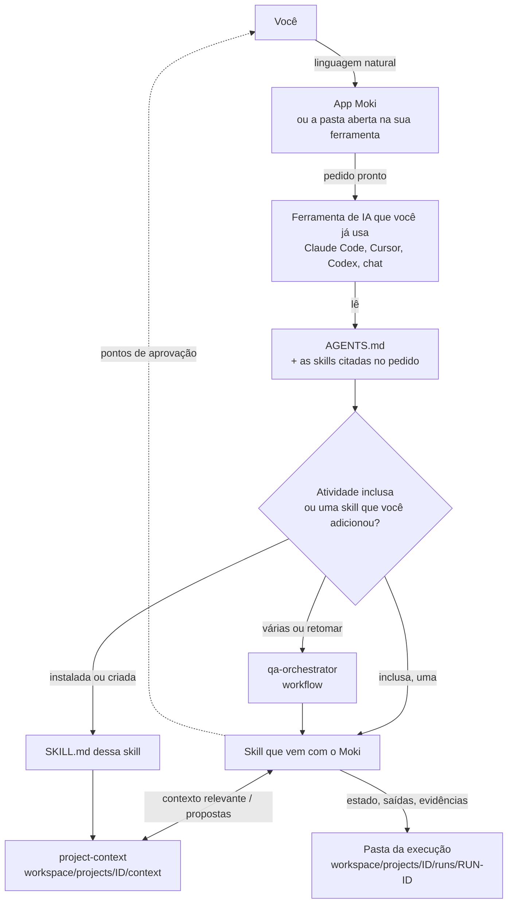
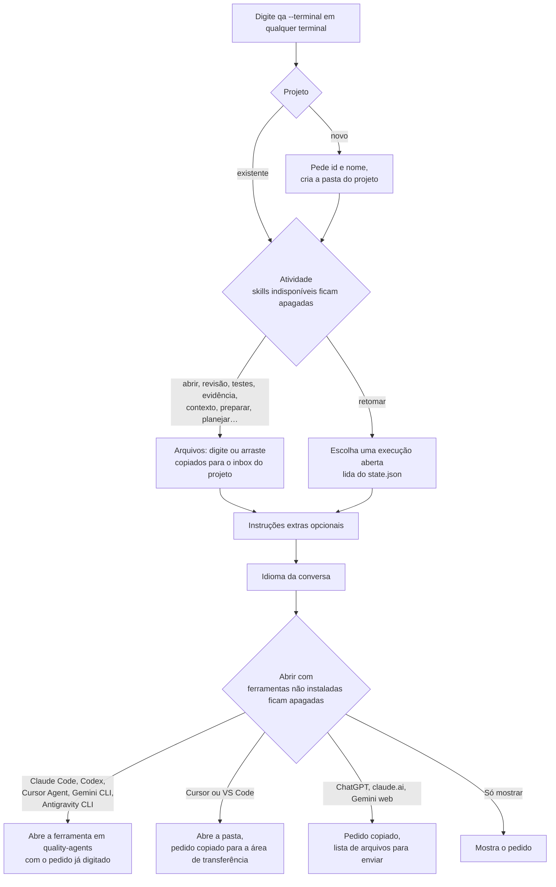
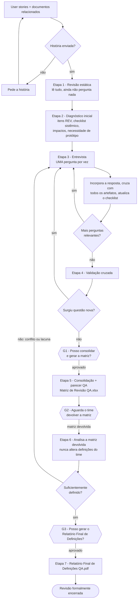
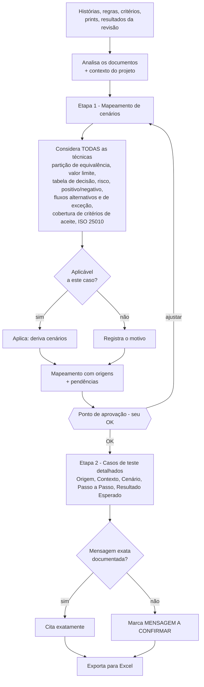
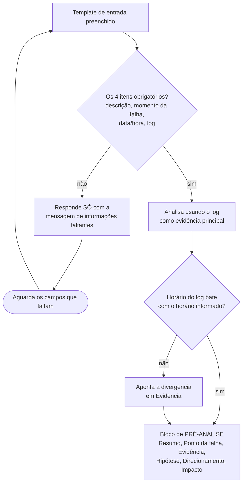
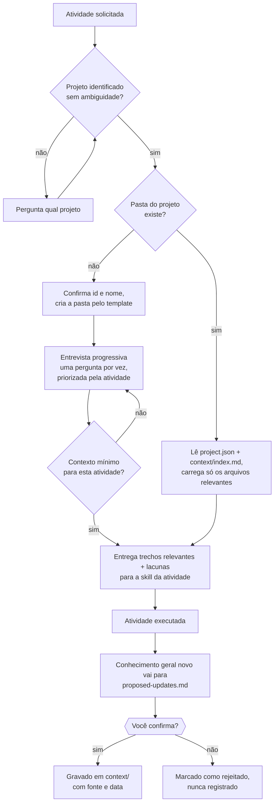
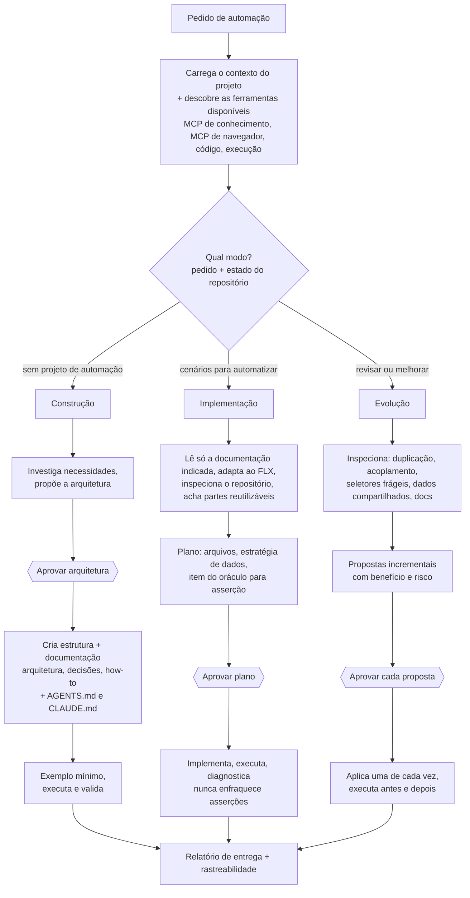
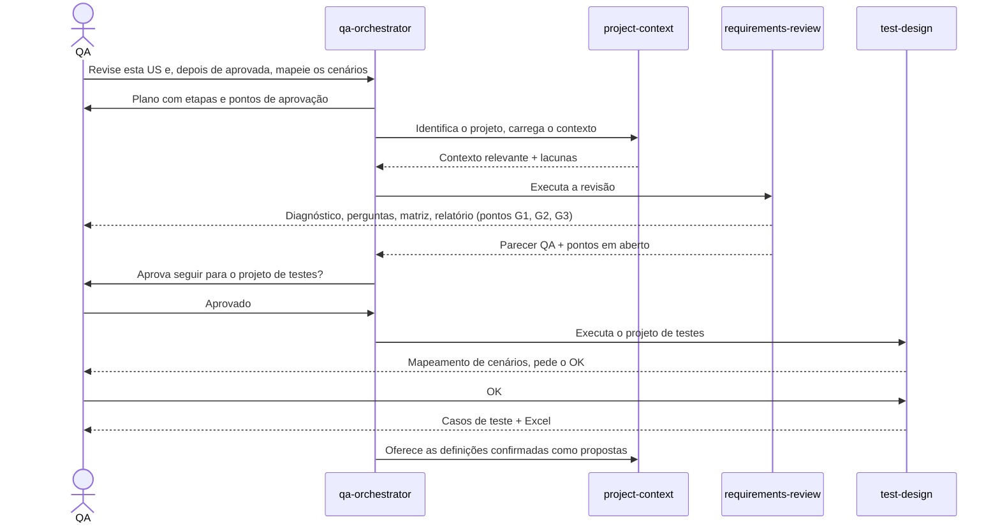
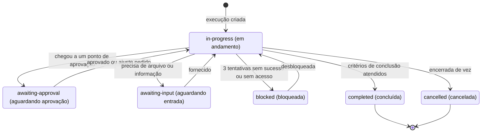
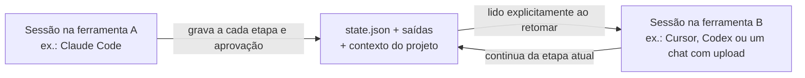

# Moki

🇺🇸 [Read in English](README.md)

<p align="center"></p>

<p align="center">
  <a href="https://github.com/Orsi88/quality-agents/releases/latest"><b>⬇️ Baixar o Moki para Windows</b></a>
  &nbsp;·&nbsp; <a href="https://github.com/Orsi88/quality-agents/releases/download/v0.2.0/Moki.Setup.0.2.0.exe">link direto (v0.2.0, .exe)</a>
  &nbsp;·&nbsp; <a href="#30-o-jeito-mais-rápido-o-instalador-para-windows">como instalar</a>
</p>

Um app local e uma biblioteca portátil de **instruções para agentes de IA**. O Moki guarda cada projeto no seu computador e abre a ferramenta de IA que você já usa — Claude Code, Cursor, Codex, ChatGPT, claude.ai, Gemini ou outra — com o pedido pronto. Ele não tem IA própria.

Nasceu para executar trabalho de qualidade de software do mesmo jeito em qualquer ferramenta: revisar histórias, projetar testes, analisar uma falha, montar evidências. Esse trabalho continua incluso. Um projeto hoje também pode ser qualquer coisa que você descreva: um projeto em branco cujo contexto a IA planeja com você, uma pasta que você já tem, e skills e agentes que você instala ou escreve (programação, design, segurança, documentação ou um procedimento seu).

Este guia é para quem usa o Moki. O app e as atividades que vêm com ele não exigem programação: instale, abra um projeto e converse com a sua ferramenta de IA em linguagem natural.

---

## Sumário

1. [O que é e o que não é](#1-o-que-é-e-o-que-não-é)
2. [Conceitos em 2 minutos](#2-conceitos-em-2-minutos)
3. [Instalação (uma vez por computador)](#3-instalação-uma-vez-por-computador)
4. [Escolha como vai usar](#4-escolha-como-vai-usar)
5. [Início rápido: sua primeira atividade em 10 minutos](#5-início-rápido-sua-primeira-atividade-em-10-minutos)
6. [Crie um projeto](#6-crie-um-projeto)
7. [Guia das skills, passo a passo](#7-guia-das-skills-passo-a-passo)
8. [Workflows: várias atividades em sequência](#8-workflows-várias-atividades-em-sequência)
9. [Pausar e retomar uma atividade](#9-pausar-e-retomar-uma-atividade)
10. [Configuração por ferramenta](#10-configuração-por-ferramenta)
11. [Onde fica cada arquivo](#11-onde-fica-cada-arquivo)
12. [Privacidade e isolamento](#12-privacidade-e-isolamento)
13. [Referência de comandos](#13-referência-de-comandos)
14. [Solução de problemas](#14-solução-de-problemas)
15. [Atualizar o framework](#15-atualizar-o-framework)
16. [Adicionar uma nova skill](#16-adicionar-uma-nova-skill)
17. [Como contribuir](#17-como-contribuir)
18. [Mapa do repositório](#18-mapa-do-repositório)

---

## 1. O que é e o que não é

**O que é**

- Um **app desktop** (instalador para Windows, ou `qa` a partir de um clone). Lista os seus projetos, mostra os arquivos e abre a sua ferramenta de IA com o pedido pronto. Não há conta nem servidor para implantar.
- Um conjunto de **skills**: instruções escritas no formato aberto [Agent Skills](https://agentskills.io) — as etapas, as regras, o formato de saída e onde o trabalho deve parar para a sua aprovação. Algumas vêm com o Moki. Outras você instala no registro público [SkillMD](https://skillmd.com) ou pede para a sua ferramenta de IA redigir.
- **Agentes**: um papel que usa uma ou mais skills, com um nível de acesso. Os papéis prontos cobrem as atividades de qualidade. Você pode duplicá-los ou criar os seus, para um projeto ou para todos.
- Um **contexto de projeto**: o conhecimento que você confirmou, em Markdown e JSON, isolado por projeto. Um projeto de qualidade começa com glossário, regras de negócio, módulos e convenções. Um projeto em branco só ganha arquivos depois que você aprova um plano.
- Um **registro de cada atividade**: entradas, saídas e um `state.json`, para você parar e continuar depois — inclusive em outra ferramenta de IA.

**O que não é**

- Não é uma IA, um chatbot nem um serviço hospedado. O Moki não responde o pedido. Quem responde é a ferramenta que você escolhe, e uma ferramenta online segue a política de dados desse fornecedor.
- Não está preso a um fornecedor de IA.
- Não substitui a sua decisão. As skills que vêm com o Moki param nos pontos de aprovação e esperam uma resposta explícita.
- Não é um depósito de dados de projeto dentro deste repositório Git. Projetos, resultados, notas e skills instaladas para um projeto ficam em `workspace/` no seu computador (ou numa pasta que você vincula). Essa árvore nunca é enviada para cá.

### Skills que vêm com o Moki

| Skill | O que faz | Status |
|---|---|---|
| `requirements-review` | Revisa user stories antes do desenvolvimento: ambiguidades, contradições, lacunas, interação entre regras, riscos. Entrevista interativa (uma pergunta por vez), Matriz de Revisão QA (Excel), Relatório Final de Definições (PDF). Nunca gera casos de teste. | draft |
| `test-design` | Mapeia cenários de teste, espera o seu OK e depois escreve casos de teste manuais detalhados, exportados para Excel. | draft |
| `failure-analysis` | Pré-análise curta de um erro a partir da sua descrição e do log, para direcionar o time de desenvolvimento à causa provável. | draft |
| `evidence-collection`, `evidence-sheet`, `evidence-document` | Evidências de teste de ponta a ponta (agente `evidence-builder`): lê o item de trabalho (Azure DevOps/Jira via MCP, ou colado) e as gravações do Jam, pede sua aprovação e gera a planilha de evidências (uma linha por caso de teste) e o documento Word com os prints, nos seus próprios modelos. | draft |
| `project-context` | Cria e mantém o conhecimento confirmado de um projeto. Num projeto em branco, entrevista você e escreve um plano que você aprova antes de qualquer arquivo de contexto ser criado. | draft |
| `qa-orchestrator` | Encadeia atividades ("revise e depois projete os testes"), garante as aprovações e retoma trabalhos interrompidos. | draft |
| `automation` | Engenharia de automação: constrói projetos de automação novos (Playwright + TypeScript primeiro) já documentados e prontos para IA, automatiza cenários FLX documentados em projetos existentes e evolui projetos existentes. | pending migration |
| `documentation`, `smoke-test` | Planejadas para uma versão futura. Se você pedir, a IA avisa que ainda não estão disponíveis. | planned |

**draft** = completa e utilizável, ainda em validação entre ferramentas de IA (veja [docs/compatibility-tests.md](docs/compatibility-tests.md)). **pending migration** = totalmente definida, aguardando o material de referência do time para poder rodar. **planned** = ainda não disponível.

Skills que você instala ou cria são extras. Elas ficam com o projeto ou na sua pasta de usuário, e o pedido que o app monta cita o nome delas para a IA ler o `SKILL.md` quando uma servir. Veja [Skills e agentes que você adiciona](#79-skills-e-agentes-que-você-adiciona).

---

## 2. Conceitos em 2 minutos

| Termo | Significado |
|---|---|
| **Skill** | As instruções de uma atividade. A IA lê; você abre o arquivo de uma skill só quando quer alterá-lo. |
| **Agente** | Um papel que faz o trabalho usando uma ou mais skills (ex.: `requirements-analyst`), com um nível de acesso. Agentes prontos podem ser duplicados, e você pode criar os seus — veja [docs/agents.md](docs/agents.md). |
| **Projeto** | Um trabalho neste computador: um sistema que você testa, um repositório que você vincula ou um projeto em branco que você descreve. Identificado por um id curto em minúsculas com hífens: `billing-portal`. |
| **Contexto do projeto** | O que a IA pode tratar como sabido: só definições que **você confirmou**. Um projeto de qualidade começa com glossário, regras, módulos, fluxos, permissões, ambientes e convenções. Um projeto em branco propõe os próprios arquivos num plano. |
| **Execução (run)** | Uma execução de uma atividade (ex.: "revisão da história US-310"). Cada execução tem um id como `20261020-0930-requirements-review-us-310` e uma pasta própria com entradas, saídas e o arquivo `state.json`. |
| **state.json** | O "save do jogo" de uma execução: etapa atual, etapas concluídas, perguntas pendentes, suas aprovações, arquivos gerados. É o que permite retomar. |
| **Ponto de aprovação** | Um momento em que a IA precisa parar e esperar a sua resposta explícita antes de continuar (ex.: "Posso gerar a Matriz de Revisão QA?"). |
| **Workspace** | A pasta `workspace/` do seu computador, onde ficam todos os dados de projetos e resultados. Nunca é versionada. |

### Como tudo se encaixa



> Os diagramas deste README usam [Mermaid](https://mermaid.js.org). O GitHub mostra as figuras automaticamente; no VS Code, instale uma extensão de preview de Mermaid para vê-las.

---

## 3. Instalação (uma vez por computador)

### 3.0 O jeito mais rápido: o instalador para Windows

1. Baixe o **Moki.Setup.0.2.0.exe** na [página de Releases](https://github.com/Orsi88/quality-agents/releases), ou use o link direto acima.
2. Execute. O Windows pode mostrar *"O Windows protegeu o computador"*, porque o instalador ainda não tem assinatura digital: clique em **Mais informações → Executar assim mesmo**.
3. Escolha a pasta de instalação e conclua. Um atalho **Moki** é criado na área de trabalho e no menu Iniciar.

Na primeira abertura o app cria **Documentos\Moki** — o framework (skills, `AGENTS.md`, templates) e a sua `workspace/`, onde ficam os projetos e resultados. A sua ferramenta de IA é aberta nessa pasta. Instalar uma versão nova atualiza os arquivos do framework ali e **nunca mexe na `workspace/`**; desinstalar o app também mantém essa pasta.

Você continua precisando de uma ferramenta de IA (Claude Code, Codex, Cursor…). O Node.js é opcional neste caminho: o app instalado abre sem ele. Ele só é necessário para os comandos auxiliares (Excel, Word e PDF).

Prefere o terminal, quer contribuir com o framework ou usa macOS/Linux? Siga os passos abaixo; para gerar o instalador do seu sistema, veja a [3.7](#37-gerar-o-instalador-do-app-desktop-windows-macos-linux).

### 3.1 O que você precisa

| Software | Para quê | Obrigatório? |
|---|---|---|
| **Git** | Baixar (clonar) e atualizar o framework a partir deste repositório | Só no caminho do clone, abaixo. O instalador para Windows não precisa de Git. |
| **Node.js 22.18 ou mais recente** (LTS) | A partir de um clone: roda o `qa`, constrói o app e os comandos auxiliares (projetos, execuções, Excel, Word, PDF, verificação de commits). O app instalado abre as ferramentas de IA sem Node.js; esses comandos auxiliares ainda precisam dele. | Num clone, sim. No instalador, só quando você quiser os comandos auxiliares. |
| **Microsoft Edge ou Google Chrome** | Usado em segundo plano para gerar os relatórios em PDF | Só para gerar PDF (o Edge já vem no Windows) |
| Uma **ferramenta de IA** | Claude Code, Cursor, Codex, claude.ai, ChatGPT, Gemini... | Sim |

### 3.2 Instalar o Git e o Node.js

**Windows**
1. Git: baixe em https://git-scm.com/download/win e instale com as opções padrão.
2. Node.js: baixe o instalador **LTS** em https://nodejs.org e instale com as opções padrão.
3. Feche e abra de novo qualquer janela de terminal.

**macOS**
1. Abra o app **Terminal** e digite `git --version`. Se o Git não estiver instalado, o macOS oferece a instalação — aceite.
2. Node.js: baixe o instalador **LTS** em https://nodejs.org e instale.

**Linux**: instale `git` e `nodejs` (versão 22.18+) pelo gerenciador de pacotes da sua distribuição.

Confira a instalação num terminal (Windows: **PowerShell** ou **Git Bash**; macOS/Linux: **Terminal**):

```bash
git --version
node --version
npm --version
```

Cada comando deve mostrar um número de versão. O `node --version` precisa ser `v22.18` ou maior.

### 3.3 Baixar o framework

Escolha uma pasta (por exemplo, Documentos) e rode:

```bash
git clone https://github.com/Orsi88/quality-agents.git
cd quality-agents
```

Se o seu time usa um fork próprio, clone esse endereço (botão "Code" do GitHub → HTTPS).

### 3.4 Rodar a configuração inicial

Ainda dentro da pasta `quality-agents`:

```bash
npm run setup
```

Leva cerca de um minuto. Ele:

1. instala as ferramentas de desenvolvimento (só dentro desta pasta),
2. constrói o app desktop,
3. cria a sua pasta local `workspace/`,
4. liga a proteção que bloqueia commits acidentais de dados de projeto ou senhas.

Termina com `Done. Start Moki with: npm run qa`. Rode `npm run setup` de novo depois de cada atualização (`git pull`).

### 3.5 Conferir se está tudo certo

```bash
npm run check
```

A saída esperada termina com `Validation passed`, `Artifact check passed` e `Secret check passed`.

### 3.6 Instalar o comando `qa` (recomendado)

Ainda dentro da pasta `quality-agents`:

```bash
npm link
```

A partir daí você pode digitar `qa` em **qualquer** pasta do terminal para abrir o app desktop do Moki ([seção 4.1](#41-o-app-desktop-qa)). Se o `npm link` der erro de permissão no macOS/Linux, use `sudo npm link`, ou pule esta etapa e rode `npm run qa` de dentro da pasta `quality-agents`.

> **Dica para Windows:** se o PowerShell disser *"a execução de scripts foi desabilitada neste sistema"* quando você digitar `npm`, use o **Git Bash**, ou digite `npm.cmd` em vez de `npm`, ou veja a [Solução de problemas](#14-solução-de-problemas).

### 3.7 Gerar o instalador do app desktop (Windows, macOS, Linux)

Opcional: para quem publica os instaladores, ou para ter o app no macOS/Linux como um programa independente. Depois da [3.4](#34-rodar-a-configuração-inicial), rode o comando do seu sistema dentro da pasta `quality-agents`. **Gere cada instalador no próprio sistema de destino** (o instalador para macOS só pode ser gerado num Mac). Os arquivos são gravados em `release/`.

| Sistema | Comando | Resultado em `release/` |
|---|---|---|
| Windows 10/11 (x64) | `npm run dist:win` | `Moki Setup <versão>.exe` |
| macOS (Intel ou Apple Silicon) | `npm run dist:mac` | `Moki-<versão>.dmg` (com `-arm64` no nome em Apple Silicon) |
| Linux (x64) | `npm run dist:linux` | `Moki-<versão>.AppImage`, além de `.deb` e `.rpm` |

Os instaladores ainda não têm assinatura digital: o Windows mostra o aviso do SmartScreen descrito na [3.0](#30-o-jeito-mais-rápido-o-instalador-para-windows); o macOS bloqueia a primeira abertura — clique com o botão direito no app → **Abrir**, ou **Ajustes do Sistema → Privacidade e Segurança → Abrir Mesmo Assim**. Em todos os sistemas, a primeira abertura cria **Documentos/Moki**, como na 3.0.

#### Linux: distribuições e versões

O build para Linux é um único `.AppImage`: um arquivo que roda sem instalação em qualquer distribuição x64 com **glibc 2.25 ou mais recente** e ambiente gráfico (GTK 3). Para gerá-lo basta Git e Node.js 22.18+ — sem compilador nem pacotes extras.

| Distribuição | Versões | Pacote FUSE 2 que o AppImage precisa |
|---|---|---|
| Ubuntu | 22.04 LTS | `sudo apt install libfuse2` |
| Ubuntu | 24.04 LTS ou mais recente | `sudo apt install libfuse2t64` (veja a nota sobre AppArmor abaixo) |
| Debian | 12 ou mais recente | `sudo apt install libfuse2` (Debian 13: `libfuse2t64`) |
| Linux Mint / Pop!_OS / elementary OS | Mint 21+, Pop!_OS 22.04+, elementary OS 7+ | o mesmo pacote da versão do Ubuntu em que se baseiam |
| Fedora | 42 ou mais recente | `sudo dnf install fuse-libs` |
| RHEL / Rocky Linux / AlmaLinux | 9 ou mais recente | `sudo dnf install fuse-libs` |
| openSUSE | Leap 15.6, Tumbleweed | `sudo zypper install libfuse2` |
| Arch / Manjaro | rolling | `sudo pacman -S fuse2` |

Para executar: `chmod +x "Moki-<versão>.AppImage"` e depois dê dois cliques no arquivo ou abra-o pelo terminal.

- **Nenhuma entrada no menu** é criada. Deixe o arquivo numa pasta fixa (ex.: `~/Applications`); ferramentas como AppImageLauncher ou Gear Lever podem adicioná-lo ao menu.
- **Ubuntu 24.04 ou mais recente:** o AppArmor bloqueia o sandbox usado por apps Electron, e o AppImage pode fechar logo ao abrir com um erro de *"sandbox"*. Abra-o com `"./Moki-<versão>.AppImage" --no-sandbox` (isso desliga o sandbox do Chromium para este app).
- **ARM64:** gere numa máquina ARM64 com `npm run app:build` e depois `npx electron-builder --linux AppImage --arm64`.

---

## 4. Escolha como vai usar

| Se você usa... | Modo | O que muda |
|---|---|---|
| **Claude Code, Cursor ou Codex** (ferramentas que abrem uma pasta do seu computador) | **Modo agente** — recomendado | A IA lê diretamente as skills, o contexto do projeto e os seus arquivos, salva os resultados nas pastas certas e consegue gerar Excel/PDF. Você só conversa com ela. |
| **claude.ai, ChatGPT, Gemini** (chat no navegador ou app) | **Modo chat** | Você envia as skills uma vez e, em cada atividade, envia os arquivos necessários e salva o que a IA produzir. Veja a [seção 10.4](#104-claudeai-chatgpt-gemini-e-outras-ferramentas-de-chat). |

E três formas de trabalhar, seja qual for a ferramenta:

| Forma | Para quem |
|---|---|
| **O app desktop — `qa`**: tela inicial com seus projetos e notas soltas, e depois um workspace no estilo do Obsidian para navegar, ler e editar os arquivos do projeto e **abrir o projeto na sua ferramenta de IA com o pedido pronto**. | Todo mundo — o jeito mais fácil |
| **O menu de terminal — `qa --terminal`**: projeto → atividade → arquivos → ferramenta de IA; prepara tudo e abre a sua ferramenta de IA com o pedido pronto. | Quem não quer lidar com pastas e prompts |
| **Abrir a pasta `quality-agents`** na sua ferramenta de IA e pedir em linguagem natural | Quem já está à vontade com a ferramenta de IA. O `AGENTS.md` encaminha essa conversa pelas skills inclusas. Uma skill que você instalou é citada quando o app ou o `qa --terminal` monta o pedido; numa sessão que você mesmo abriu, cite o nome dessa skill. |

### 4.1 O app desktop (`qa`)

Digite `qa`, ou use o atalho da área de trabalho criado pelo instalador. O Moki abre numa janela própria — sem navegador, sem servidor.

**Tela inicial** — seus projetos à esquerda. Fixe um para mantê-lo no topo. *Desvisualizar* tira o projeto da lista e os arquivos continuam neste computador; ele vai para **Ocultos**, e o olho mostra de novo. Para criar um projeto, basta digitar o nome. Esse formulário ainda diz "um projeto por sistema que você testa"; um projeto em branco e uma pasta vinculada usam o mesmo formulário. O último projeto usado reabre automaticamente. O canto escolhe **inglês ou português** e o tema **claro ou escuro**; a primeira abertura pergunta os dois.

**Workspace** (como o Obsidian):

| Área | O que faz |
|---|---|
| **Faixa de ícones à esquerda** | Todos os projetos · Abrir na sua ferramenta de IA · Novo terminal · Abrir a pasta do projeto · Vincular uma pasta · Configurações · Atualizar · Mostrar/ocultar o painel lateral |
| **Árvore de arquivos** | *Context* (conhecimento confirmado), *Inbox* (arquivos que você entrega à IA), *Activities* (cada execução, com data e ponto de status), *Notes*, atualizações propostas e histórico |
| **Documentos em abas** | Markdown aparece formatado; **Ctrl+E** alterna para edição, **Ctrl+S** salva, **Ctrl+W** fecha. Arquivos Word mostram o texto; JSON, texto e imagens têm pré-visualização; Excel e PDF abrem no programa deles |
| **Painel lateral** | Numa atividade: status, etapa atual, pendências, aprovações e arquivos gerados, além de *Continuar na sua ferramenta de IA*. Fora dela: visão geral do projeto, **agentes habilitados no projeto** (caixas de seleção), atividades em aberto e **Visualização em grafo** (a aba diz que está em construção) |
| **Abrir na sua ferramenta de IA** | Escolha a atividade, opcionalmente **quem deve fazer** (um agente), os arquivos do inbox, adicione uma observação e escolha a ferramenta: Claude Code, Codex, Gemini CLI, Antigravity CLI ou Cursor Agent abrem numa aba de terminal do app; Cursor ou VS Code abrem a pasta com o pedido copiado; ChatGPT / claude.ai / Gemini web, e *Just show the request*, deixam o texto na etapa de revisão pronto para copiar. O pedido cita a pasta vinculada e as skills e os agentes instalados naquele projeto. Se a abertura ainda estiver rodando depois de cerca de 20 segundos, o assistente avisa que o pedido está demorando, em vez de ficar em "Opening…". |
| **Configurações** | A engrenagem na faixa de ícones. Três abas: **Agentes**, **Skills** e **Modelos**. |
| **Agentes** | Agentes por categoria, com papel, skills e acesso. **Duplicar** grava a cópia de um agente pronto em `workspace/library/agents/`; depois você **Edita** e **Salva** (validado antes de salvar) ou exclui. **Criar agente** grava um novo só deste projeto (`<pasta vinculada>/.claude/agents/`, ou `workspace/projects/<id>/agents/` quando nada está vinculado) ou de todos os projetos (`~/.claude/agents/`). |
| **Skills** | **Já instaladas** (cada skill mostra onde mora), **Nativas e criadas** (as skills que vêm com o Moki e as que você criou — essa lista não cria skill) e **Adicionar skill**. Adicionar uma skill busca no registro público SkillMD (programação, design, QA e testes, segurança, documentação e escrita), ou **Criar skill** descreve uma para a sua ferramenta de IA redigir. Uma skill deste projeto fica em `<pasta vinculada>/.claude/skills/` ou em `workspace/projects/<id>/skills/`. Uma skill de todos os projetos fica em `~/.claude/skills/` e `~/.agents/skills/`. |
| **Modelos** | Como ficam os arquivos PDF, Word e Excel que as atividades e os agentes geram: fonte, cores, cabeçalho, rodapé, logo e marca d'água em texto, com uma prévia da página. Um estilo para todos os projetos, ou o estilo próprio de um projeto. O logo (PNG, JPEG, WebP ou GIF) e a marca d'água vão para PDF e Word; o Excel guarda os textos do cabeçalho na impressão. **Salvar** vale para os arquivos novos. |

- **Soltar arquivos**: solte arquivos sobre o workspace e eles são copiados para o inbox daquele projeto. Pastas são ignoradas. Até 40 arquivos, cada um de até 200 MB. A mesma ação de ocultar da tela inicial fica na árvore (*Desvisualizar*).
- **Ao vivo**: os arquivos que a IA grava aparecem na árvore assim que são salvos.
- **Arquivos Word**: arquivos `.docx` são convertidos em texto automaticamente para qualquer IA conseguir ler.
- **Notas**: as notas do projeto são arquivos Markdown em `notes/` e abrem numa janela própria. As notas soltas da tela inicial ficam no app até você enviar uma para um projeto.
- **Sessões que o app abre**: Claude Code e Codex iniciados pelo Moki também carregam os plugins de `adapters/app-plugins/` (ponytail, e rtk quando esse comando está instalado). A mesma ferramenta iniciada fora do app não carrega esses plugins. Um plugin cujo requisito falta é ignorado.
- **Local e privado**: os dados do projeto vêm dos arquivos em `workspace/` e de uma pasta que você vincula. Sem conta, sem hospedagem, sem banco de dados.
- Como foi construído (para quem contribui): [docs/desktop-app.md](docs/desktop-app.md).

As seções a seguir descrevem primeiro o **modo agente**. As diferenças do modo chat aparecem onde for relevante.

### 4.2 O menu de terminal (`qa --terminal`)

O `qa --terminal` é um pequeno menu que roda no terminal. **Ele não tem IA própria e não chama nenhum serviço online**: só copia os seus arquivos para a pasta certa do projeto, escreve o pedido para você e abre a ferramenta de IA que você já usa.



A interface do `qa` é em inglês. A pergunta *Which project (system under test)?* é o rótulo do próprio menu; um projeto em branco ou com pasta vinculada usa a mesma pergunta.

Use **↑/↓** para mover, **Enter** para escolher (ou digite o número da opção) e **Ctrl+C** para cancelar. Cada resposta "recolhe" depois de escolhida, então a tela fica limpa. Enquanto uma pergunta está aberta, ela fica assim:

```text
┌  Moki
│  Prepares your request and opens the AI tool you use. Your data stays in workspace/.
│
◇  Which project (system under test)?
│  billing-portal
│
◆  What do you want to do?
│  ● Just open the project  loads the context and asks what you need
│  ○ Review user stories  ambiguities, gaps, interview, matrix, report
│  ○ Design tests
│  ○ Review, then design tests
│  ○ Failure pre-analysis
│  ○ Build test evidence  work item + Jam recordings, then spreadsheet and Word document
│  ○ Project context
│  ○ Prepare the project  adapts the context to the project description
│  ○ Plan the project with the AI  interview, then a plan you review in the app
│  ○ Automation  (not available yet: pending-migration)
│  ○ Resume a run  (no open runs)
└  ↑/↓ move · Enter select · Ctrl+C cancel
```

Uma sessão completa, ao final:

```text
┌  Moki
│
◇  Which project (system under test)?
│  billing-portal
│
◇  What do you want to do?
│  Review user stories
│
◇  Input file
│  C:\Users\eu\Downloads\US-310.docx
│
│  ✔ File 1 → workspace/projects/billing-portal/inbox/US-310.docx
◇  Anything else the AI should know?
│  focar em permissões
│
◇  Conversation language
│  Portuguese (pt-BR)
│
◇  Open with
│  Claude Code
│
◇  Summary
│  Project   billing-portal
│  Activity  Review user stories
│  Files     workspace/projects/billing-portal/inbox/US-310.docx
│  Note      focar em permissões
│  Language  Portuguese (pt-BR)
│  Tool      Claude Code
│
◇  Open Claude Code now?
│  Yes
│
│  Request (also saved in workspace/temporary/last-prompt.txt):
│  Follow AGENTS.md. Project: billing-portal. Use the requirements-review skill to review the user stories in: ...
└  Opening Claude Code …
```

Escolhendo **Portuguese (pt-BR)** em *Conversation language*, a IA conversa com você em português.

Em terminais sem suporte a cores ou setas (ou quando a entrada é redirecionada), o `qa` passa automaticamente para menus numerados. Você também pode forçar isso com `qa --plain`.

Daí em diante você continua a conversa na ferramenta de IA normalmente. O `qa` lembra o último projeto, idioma e ferramenta usados (guardados em `workspace/`, nunca versionados). O último pedido também fica salvo em `workspace/temporary/last-prompt.txt`.

**Atalho sem menus** (todas as opções numa linha):

```bash
qa --project billing-portal --activity review --file ~/Downloads/US-310.docx --tool claude --lang "Portuguese (pt-BR)"
qa --project billing-portal --activity resume --run 20261020-0930-requirements-review-us-310 --tool codex
qa --help
```

| Opção | Valores |
|---|---|
| `--activity` | `open` (só abrir), `review` (revisão), `tests` (testes), `review-then-tests` (revisão e depois testes), `failure` (falha), `evidence` (evidências), `context` (contexto), `setup` (preparar), `plan` (planejar), `automation` (automação), `resume` (retomar) |
| `--tool` | `claude`, `codex`, `cursor-agent`, `gemini`, `antigravity`, `cursor`, `vscode`, `chat`, `print` |
| `--file` | Repita para vários arquivos |
| `--run` | Id da execução, para `resume` |
| `--note` | Instruções extras |
| `--lang` | Idioma da conversa, ex.: `English`, `"Portuguese (pt-BR)"` |

---

## 5. Início rápido: sua primeira atividade em 10 minutos

Este passo a passo usa uma atividade de qualidade que vem com o Moki e o sistema fictício **Acme Library**, em [examples/](examples/README.md). Os mesmos passos — projeto, pedido, pasta da execução — são como toda atividade fica registrada. Um projeto em branco ou uma skill que você instalou segue as próprias instruções quando o pedido cita o nome dela.

> **Atalho:** se você instalou o comando `qa` ([3.6](#36-instalar-o-comando-qa-recomendado)), digite `qa --terminal` e siga o menu — ele faz os passos 1 e 2 por você.

**Passo 1 — Abra a pasta na sua ferramenta de IA**
- Claude Code: no terminal, `cd quality-agents` e depois `claude` (ou abra a pasta na extensão do VS Code / no app desktop).
- Cursor: *File → Open Folder* → selecione `quality-agents`.
- Codex: no terminal, `cd quality-agents` e depois `codex`.

**Passo 2 — Peça uma atividade em linguagem natural**

Digite:

> Crie o projeto Acme Library e faça uma pré-análise de falha com o arquivo examples/failure-analysis/complete-report.txt

**Passo 3 — Acompanhe o que acontece**

1. A IA confirma o id (`acme-library`) e o nome do projeto e cria `workspace/projects/acme-library/`.
2. Ela pode fazer uma ou duas perguntas de contexto — responda rapidamente ou diga "pula por enquanto".
3. Ela cria uma execução, analisa o relatório e responde com um bloco que começa com `[PRE-ANALYSIS]` (ou `[PRÉ-ANÁLISE]` se o idioma dos entregáveis do projeto for `pt-BR`).
4. O resultado é salvo em `workspace/projects/acme-library/runs/<run-id>/outputs/pre-analysis.txt`.

**Passo 4 — Confira o resultado de forma objetiva (opcional)**

```bash
npm run check-output -- pre-analysis workspace/projects/acme-library/runs/<run-id>/outputs/pre-analysis.txt
```

Pronto, você já usou o framework. As próximas seções explicam cada parte em detalhe.

---

## 6. Crie um projeto

Um projeto é um trabalho neste computador. Ele tem um id curto (`billing-portal`) e uma pasta em `workspace/projects/`. Três jeitos de começar:

| Começo | O que você ganha |
|---|---|
| **Arquivos de contexto de QA** (o padrão) | A pasta de qualidade da [6.3](#63-o-que-existe-dentro-da-pasta-de-um-projeto): glossário, regras, módulos, fluxos, permissões e o resto. Use isto para um sistema que você testa. |
| **Um projeto em branco** | Ainda sem `context/`. Você descreve o objetivo; a IA entrevista você e escreve um plano. Os arquivos de contexto só são criados depois da sua aprovação. No app, escolha *Um projeto em branco*. No terminal: `npm run new-project -- <id> "<Nome>" --blank`. |
| **Uma pasta que já existe** | Na tela inicial, *Abrir um projeto* escolhe uma pasta. O projeto recebe o nome dela (você pode editar), é vinculado e abre em *Configurar &lt;nome&gt;*. As configurações de IA dessa pasta (`.claude`, `.agents`, `.codex`, `.gemini`, `.cursor`, `CLAUDE.md`, `AGENTS.md`, `GEMINI.md`) são copiadas para `.moki-backup/link-<data>/` dentro dela. Nada mais na pasta muda. Pedidos abertos a partir do projeto citam essa pasta. |

Vincular uma pasta a um projeto que já existe é o botão de vínculo na faixa de ícones. Instalar uma skill ou um agente no `.claude` dessa pasta pede a sua confirmação, faz backup do `.claude` antes e é recusado quando a entrada daquele repositório diz `writeAllowed: false`.

### 6.1 Automático (recomendado)

Basta mencionar o projeto ao pedir uma atividade:

> Revise esta história do **Billing Portal**.

Se o projeto ainda não existir, a skill `project-context`:

1. Propõe um id (`billing-portal`) e pede para você confirmar o id e o nome de exibição.
2. Cria a pasta a partir do template.
3. Inicia uma **entrevista progressiva**: uma pergunta por vez, começando pelo que a atividade pedida precisa (para uma revisão: o que o sistema faz, quais módulos são afetados, se ele tem várias empresas, vários idiomas, parâmetros configuráveis, e-mails, histórico/auditoria...).
4. Para assim que a atividade tem o mínimo necessário e informa o que ainda falta. O resto é coletado com o tempo.

Dicas para a entrevista:
- Responda "não sei" à vontade — isso é registrado como *desconhecido*, que é diferente de "não se aplica".
- Se você tem documentação (manual funcional, catálogo de regras), coloque-a antes na pasta `inbox/` do projeto. A IA lê, propõe o que encontrou e pede confirmação em lotes, em vez de perguntar tudo.
- A IA nunca pede senhas. Nunca digite uma senha no contexto.

### 6.2 Manual

```bash
npm run new-project -- billing-portal "Billing Portal"
```

Depois preencha `workspace/projects/billing-portal/project.json` (ou deixe a IA fazer isso na próxima atividade).

### 6.3 O que existe dentro da pasta de um projeto

Um projeto que começa com os arquivos de contexto de QA fica assim. Um projeto em branco tem o mesmo `project.json`, `proposed-updates.md`, `activity-log.md`, `inbox/` e `runs/`, mais o `plan.json` quando a entrevista já tem um plano, e não tem `context/` até você aprovar esse plano. O `project.json` registra `"starter": "qa"` ou `"starter": "blank"`.

```text
workspace/projects/billing-portal/
├── project.json            # nome, ambientes, repositórios, ferramentas, restrições, política de compartilhamento de dados
├── context/                # SOMENTE conhecimento confirmado
│   ├── index.md            # lista dos arquivos de contexto (a IA lê primeiro)
│   ├── overview.md         # propósito, usuários, escopo
│   ├── glossary.md         # termos do domínio
│   ├── modules.md          # módulos e telas
│   ├── actors-and-permissions.md
│   ├── business-rules.md   # regras com ids oficiais e fontes
│   ├── flows.md            # fluxos, estados, transições
│   ├── system-characteristics.md   # multiempresa, idiomas, parâmetros, e-mails, auditoria... + verificações do time
│   ├── integrations.md
│   ├── environments-and-tools.md   # URLs, repositórios, onde ficam os logs (nunca credenciais)
│   └── conventions.md      # idioma dos entregáveis, formatos de id, templates, arquitetura de automação
├── proposed-updates.md     # conhecimento encontrado nas atividades, aguardando sua confirmação
├── activity-log.md         # uma linha por atividade
├── inbox/                  # coloque aqui os seus arquivos de entrada
├── runs/                   # uma pasta por atividade
└── temporary/
```

### 6.4 Como o contexto cresce

Durante qualquer atividade, a IA pode descobrir algo que parece uma regra geral do sistema (por exemplo, "só supervisores aprovam prorrogações"). Ela **não** grava isso direto em `context/`. Ela adiciona em `proposed-updates.md` e, no fim da atividade, pergunta:

> Isso é uma regra geral do sistema ou específica desta história?

Só depois da sua confirmação o item vai para o arquivo certo em `context/`, com fonte e data. Você também pode pedir a qualquer momento:

> Mostre as atualizações de contexto pendentes do Billing Portal.
> Adicione ao glossário do Billing Portal: "Dunning" é a sequência automática de e-mails de cobrança.
> O que você sabe sobre as permissões do Billing Portal?

### 6.5 Verificações específicas do time

Se o seu time sempre verifica algo particular do seu sistema (por exemplo, um recurso chamado "Acumulador de E-mails"), registre isso em `context/system-characteristics.md`, na seção **Project-specific review checks**. As skills de revisão e de projeto de testes avaliam essas verificações toda vez, usando os nomes do seu time.

### 6.6 Idioma dos entregáveis

Os entregáveis saem em **inglês** por padrão. Para mudar em um projeto, defina em `workspace/projects/<project-id>/project.json`:

```json
"deliverableLanguage": "pt-BR"
```

Ordem de precedência: o que você pedir na atividade → o `deliverableLanguage` do projeto → inglês. A conversa sempre segue o idioma em que você escreve, e mensagens citadas dos seus documentos ficam no idioma original. Rótulos disponíveis: `en` e `pt-BR` (o processo original do time).

### 6.7 Compartilhar o contexto de um projeto com o time (opcional)

O contexto é Markdown e JSON simples. Para compartilhá-lo, versione **a pasta daquele projeto** em um repositório Git **privado** separado:

```bash
cd workspace/projects/billing-portal
git init
git add .
git commit -m "Contexto do Billing Portal"
git remote add origin <url-do-seu-repositorio-privado>
git push -u origin main
```

A pasta do projeto já vem com um `.gitignore` que deixa de fora `runs/`, `inbox/` e `temporary/`, então os resultados das atividades continuam privados e sem versionamento. Os colegas clonam esse repositório privado dentro do próprio `workspace/projects/billing-portal/`. Nunca coloque contexto de projeto no repositório público do Moki.

---

## 7. Guia das skills, passo a passo

Os guias desta seção são as skills que **vêm com o Moki**. Uma skill que você instala ou cria segue o próprio `SKILL.md`; a [7.9](#79-skills-e-agentes-que-você-adiciona) diz onde ela fica e como um pedido cita o nome dela.

As skills inclusas seguem os mesmos hábitos:

- A IA **identifica o projeto primeiro** e carrega só o contexto que a atividade precisa.
- Ela cria uma **execução** e salva tudo em `workspace/projects/<project-id>/runs/<run-id>/`.
- Ela **para nos pontos de aprovação** e espera. Palavras como "ok", "aprovado", "pode seguir" aprovam o ponto em questão; qualquer outra coisa não é aprovação.
- Ela **nunca inventa** requisitos, regras, mensagens ou dados — informação que falta vira uma pendência.
- Ela **conversa com você no seu idioma**, mas **os entregáveis saem em inglês por padrão** (o framework é internacional). Para receber entregáveis em outro idioma, defina por projeto — `"deliverableLanguage": "pt-BR"` no `project.json` — ou peça na atividade ("gere a matriz em português"). Mensagens citadas dos seus documentos nunca são traduzidas. Veja a [seção 6.6](#66-idioma-dos-entregáveis).

### 7.1 Revisão de requisitos (`requirements-review`)

**Quando:** antes do desenvolvimento e antes do projeto de testes, para garantir que uma user story é clara, consistente e testável.

**Você fornece:** uma ou mais user stories e o que houver relacionado — regras de negócio, critérios de aceite, prints, protótipos, fluxos. Coloque os arquivos no `inbox/` do projeto.

**Como começar:**

> Revise a US workspace/projects/billing-portal/inbox/us-310.md do projeto billing-portal.

(No Claude Code você também pode digitar `/requirements-review`.)

**Como funciona:**



Os hexágonos são pontos de aprovação: a IA para e espera por você.

**O que acontece, etapa por etapa:**

| Etapa | O que a IA faz | O que você faz |
|---|---|---|
| 1. Revisão estática | Lê tudo antes de perguntar qualquer coisa | Aguarda |
| 2. Diagnóstico inicial | Apresenta: USs analisadas, entendimento, problemas (`[REV-001]`, `[REV-002]`...), checklist sistêmico, impactos aparentes, necessidade de prototipação. Ainda sem parecer. | Lê |
| 3. Entrevista | Faz **uma pergunta por vez**, começando pelas contradições, depois ambiguidades, regras fundamentais, interação entre regras, permissões... | Responde cada pergunta. Seja específico: "quem tiver permissão" vai ser questionado ("qual permissão?"). Se não souber, diga. Se tiver print ou protótipo, envie. |
| 4. Validação cruzada | Revisa tudo de novo com as suas respostas; volta à entrevista se surgir algo novo | Responde o que faltar |
| **Ponto G1** | Pergunta: *"Concluí a validação cruzada e não identifiquei outras questões relevantes. Posso consolidar a revisão e gerar a Matriz de Revisão QA?"* | Responde "sim" (ou pede ajustes) |
| 5. Consolidação | Resumo, definições, impactos, alterações necessárias nas histórias, pendências, **parecer QA** e o arquivo da **Matriz de Revisão QA** (Excel com 7 abas) | Abre o Excel |
| **Ponto G2** | Aguarda a matriz voltar | Compartilha o Excel com o time (PO, dev, analista). Preenche as respostas dos pontos pendentes/bloqueados. Salva na pasta `inputs/` da execução ou no `inbox/` do projeto e avisa a IA: "Segue a matriz devolvida." |
| 6. Análise da matriz devolvida | Lê todas as abas, identifica o que mudou, procura novas contradições. Nunca altera as definições do time. Volta à entrevista de uma pergunta por vez se precisar. | Responde se for perguntado |
| **Ponto G3** | Pergunta: *"A matriz está suficientemente consolidada para formalização. Posso gerar o Relatório Final de Definições em PDF?"* | Responde "sim" |
| 7. Relatório final | Gera o **Relatório Final de Definições** em PDF: uma especificação consolidada (não uma ata de reunião) | Compartilha com o time |

A revisão só é formalmente encerrada depois do PDF. Você pode parar em qualquer ponto e retomar depois ([seção 9](#9-pausar-e-retomar-uma-atividade)).

**Resultados** (em `workspace/projects/<project-id>/runs/<run-id>/outputs/`): `review-matrix.json`, a matriz em Excel, `final-report.md` e o relatório em PDF.

| Idioma dos entregáveis | Arquivos | Pareceres |
|---|---|---|
| Inglês (padrão) | `QA Review Matrix.xlsx`, `QA Final Definitions Report.pdf` | READY / READY WITH CAVEATS / NOT READY |
| `pt-BR` | `Matriz de Revisão QA.xlsx`, `Relatório Final de Definições QA.pdf` | APTA / APTA COM RESSALVAS / NÃO APTA |

**Confira a matriz de forma objetiva:**

```bash
npm run check-output -- review-matrix workspace/projects/<project-id>/runs/<run-id>/outputs/review-matrix.json
```

### 7.2 Projeto de testes (`test-design`)

**Quando:** você precisa de casos de teste manuais para uma história ou mudança — de preferência depois da revisão.

**Você fornece:** user stories, regras de negócio, critérios de aceite, prints, tabelas, fluxogramas, anotações. Se houve revisão, a IA usa as definições finais dela.

**Como começar:**

> Mapeie os cenários de teste de workspace/projects/billing-portal/inbox/us-310.md

**Como funciona:**



**O que acontece:**

1. **Etapa 1 — Mapeamento de cenários.** A IA lista os cenários agrupados por história/regra, cada um com a sua origem:

   ```text
   ### 🔸 US:310 / RN.004 – Cálculo de multa por atraso
   🔹 Cenário: Multa aplicada no primeiro dia após o vencimento – (Origem: US:310 / RN.004)
   🔹 Cenário: Sem multa no próprio dia do vencimento – (Origem: Critério de Aceite)
   ```

   Ela também lista quais técnicas de teste aplicou (partição de equivalência, valor limite, tabela de decisão, risco, positivo/negativo, fluxos alternativos/de exceção, cobertura de critérios de aceite, ISO 25010), por que alguma não se aplicou, e as pendências (ex.: uma mensagem cujo texto exato não está documentado).
2. **Ponto de aprovação — seu OK.** Revise o mapeamento. Peça inclusões/exclusões ou diga "OK, detalhe os casos de teste."
3. **Etapa 2 — Casos de teste detalhados**, com valores concretos (ex.: `17`, `18`, `19` em torno de um limite de 18), mensagens exatas entre aspas quando documentadas (mantidas no idioma original) e um marcador de pendência quando o texto não está documentado.
4. **Exportação** para Excel.

| Idioma dos entregáveis | Arquivo | Colunas | Mensagem não documentada |
|---|---|---|---|
| Inglês (padrão) | `Test Cases.xlsx` | Source, Context, Scenario, Steps, Expected Result | `[MESSAGE TO CONFIRM]` |
| `pt-BR` | `Casos de Teste.xlsx` | Origem, Contexto, Cenário, Passo a Passo, Resultado Esperado | `[MENSAGEM A CONFIRMAR]` |

**Confira os casos de teste de forma objetiva** (verifica campos obrigatórios, passos numerados, duplicidades e se cada mensagem citada existe mesmo nos seus documentos):

```bash
npm run check-output -- test-cases workspace/projects/<project-id>/runs/<run-id>/outputs/test-cases.json --source workspace/projects/<project-id>/inbox/us-310.md
```

Se o seu projeto usa outro template de casos de teste, descreva-o em `context/conventions.md` do projeto.

### 7.3 Análise de falhas (`failure-analysis`)

**Quando:** você encontrou um erro e quer dar ao time de desenvolvimento uma direção rápida e objetiva.

**Você fornece** — copie o [template de entrada](skills/failure-analysis/references/input-template.md) e preencha:

| Campo | Obrigatório |
|---|---|
| Descrição do item: fluxo, ação executada, resultado esperado, resultado obtido | Sim |
| Momento da falha (em qual etapa) | Sim |
| Data/hora da evidência (aproximada) | Sim |
| Log: trecho relevante com o erro e o stack trace | Sim |
| Observações: acontece sempre? variações? | Não |

**Como começar:** cole o template preenchido (ou salve no `inbox/` e indique o arquivo).

**Como funciona:**



**O que acontece:**

- Se faltar algum campo obrigatório, a IA **não** analisa. Ela responde apenas:

  ```text
  Para iniciar a pré-análise, preciso das seguintes informações:
  - [somente os campos faltantes]
  ```

- Com tudo preenchido, ela devolve um bloco curto, em formato de bloco de notas (em `pt-BR` quando esse for o idioma dos entregáveis; em inglês, os rótulos são [PRE-ANALYSIS], Summary, Failure point, Evidence, Hypothesis, Direction, Impact):

  ```text
  [PRÉ-ANÁLISE]

  Resumo:
  - ...
  Ponto da falha:
  - ...
  Evidência:
  - ...
  Hipótese:
  - ... (sempre como probabilidade, nunca como certeza)
  Direcionamento:
  - ...
  Impacto:
  - ...
  ```

Copie para o defeito ou envie ao desenvolvedor. Dica: registre onde ficam os logs do seu sistema em `context/environments-and-tools.md` do projeto, para a IA poder indicar o lugar certo ao time de desenvolvimento.

### 7.4 Contexto do projeto (`project-context`)

Usada automaticamente no início de toda atividade.



Os projetos nunca se misturam: a IA lê e grava somente dentro da pasta do projeto ativo.

Você também pode chamá-la diretamente:

| Você quer... | Diga |
|---|---|
| Ver o que já se sabe | "O que você sabe sobre o Billing Portal?" |
| Completar o onboarding | "Continue o onboarding do Billing Portal." |
| Adicionar uma definição | "Adicione às regras de negócio do Billing Portal: RN.012 — ..." |
| Revisar propostas pendentes | "Mostre as atualizações de contexto pendentes do Billing Portal." |
| Corrigir uma definição | "Altere o termo 'Dunning' no glossário do Billing Portal para ..." (a IA mostra o texto antigo e o novo e pede confirmação) |

### 7.5 Orquestrador (`qa-orchestrator`)

Usado quando você pede mais de uma atividade, quando quer retomar algo ou quando não está claro qual skill se aplica. Veja a [seção 8](#8-workflows-várias-atividades-em-sequência).

### 7.6 Automação (`automation`) — aguardando migração

Definida, mas ainda não executável até o material de referência do time ser migrado (projeto de automação de referência, template FLX de cenários, plano de implementação de referência). Até lá, a IA explica isso e para. O que ela vai fazer:

| Modo | Você pede | Ela entrega |
|---|---|---|
| **Construção** | "Crie um projeto de automação para o Billing Portal" | Proposta de arquitetura para sua aprovação → estrutura do projeto no seu repositório de automação → **documentação da arquitetura e de como/por que foi construída** (`docs/architecture.md`, `docs/decisions.md`, `docs/how-to.md`) → **arquivos de orientação para IA** (`AGENTS.md`, `CLAUDE.md`) para qualquer pessoa continuar trabalhando no projeto diretamente com qualquer ferramenta de IA → teste de exemplo mínimo, validado executando |
| **Implementação** | "Automatize os cenários FLX-012 e FLX-013 da página X da nossa wiki" | Lê só a documentação indicada (via MCP quando disponível) → plano de implementação com o mapeamento oráculo → asserção para sua aprovação → código reaproveitando componentes existentes → execução com resultados reais → relatório de entrega e rastreabilidade |
| **Evolução** | "Revise nosso projeto de automação" / "por que esses testes são instáveis?" | Achados baseados em evidências (duplicação, acoplamento, seletores frágeis, dados compartilhados, diagnóstico, documentação faltando) → propostas incrementais com benefício e risco, uma aprovação para cada → aplicadas e verificadas uma de cada vez |



Regras que ela sempre segue: plano e aprovação antes de mexer no código; nunca enfraquece asserções para fazer teste passar; o comportamento esperado vem da documentação, não do que aparece na tela; código de teste fica só no seu repositório de automação, nunca no Moki. Configure onde fica a sua documentação em `project.json` → `knowledgeSources`.

### 7.7 Skills planejadas

`documentation` e `smoke-test` ainda não estão disponíveis. Se você pedir, a IA explica isso e para — ela não improvisa.

### 7.8 Evidências de teste (`evidence-collection`, `evidence-sheet`, `evidence-document`)

**Quando:** um teste já foi executado e você quer a evidência montada. Isto não projeta testes e não decide um status por conta própria.

**Você fornece:** o item de origem (Azure DevOps, Jira ou similar, via MCP quando estiver configurado, ou colado), quem executou e quando, o ambiente, o resultado obtido e o status de cada caso de teste (Passed, Failed, Blocked, Not run) e pelo menos uma prova por caso executado — um link do Jam ou um print. Opcional: os seus próprios modelos `.xlsx` e `.docx`.

**Como começar:** no app ou no `qa --terminal`, escolha **Build test evidence**. Isso inicia o workflow `test-evidence` (agente `evidence-builder`).

**Como funciona:**

1. `evidence-collection` lê o item e as gravações, associa os prints a um caso e a um passo e grava `outputs/evidence.json`. Um status deduzido de uma gravação fica marcado como `proposed`. Se faltar algo obrigatório, ela pede só isso e para.
2. Ela mostra um resumo e **para para a sua aprovação**. Não inventa resultados, status nem ids.
3. Depois da sua aprovação, `evidence-sheet` preenche a planilha (uma linha por caso de teste, no seu modelo ou no padrão) e `evidence-document` gera o documento Word com as imagens, mantendo estilos, cabeçalho, rodapé e logo do seu modelo quando você entregou um.

### 7.9 Skills e agentes que você adiciona

Isso fica em Configurações (a engrenagem).

- **Adicionar skill** busca no registro público SkillMD, ou descreve uma skill para a sua ferramenta de IA redigir. As buscas prontas cobrem programação, design, QA e testes, segurança, e documentação e escrita. Cada instalação do registro mostra a auditoria e confere o sha256 de cada arquivo. Skills de terceiros são as instruções do autor delas.
- **Este projeto** guarda em `<pasta vinculada>/.claude/skills/` ou, sem pasta vinculada, em `workspace/projects/<id>/skills/`. **Todos os projetos** guarda em `~/.claude/skills/` e `~/.agents/skills/`. Um projeto também pode vincular skills globais pelo nome (`linkedSkills` no `project.json`) sem copiá-las.
- **Criar agente** faz a mesma divisão: `<pasta vinculada>/.claude/agents/` ou `workspace/projects/<id>/agents/`, ou `~/.claude/agents/` para todos os projetos. Duplicar um agente pronto continua gravando em `workspace/library/agents/`.
- O pedido que o Moki monta cita essas skills e esses agentes e manda a IA ler o `SKILL.md` ou o arquivo do agente quando servir à tarefa. O Moki não executa a skill. Instalar no `.claude` de uma pasta vinculada pede a sua confirmação e faz backup dessa pasta antes.

A atividade **Plan the project with the AI** de um projeto em branco (`--activity plan`) entrevista você uma pergunta por vez, recomenda só skills e agentes que já estão disponíveis e grava `proposed-updates.md` e `plan.json`. Você revisa o plano no app. Os arquivos de contexto só são criados depois de `"approved": true`.

---

## 8. Workflows: várias atividades em sequência

Descreva a sequência numa frase:

> Revise esta US, identifique lacunas e, depois de aprovada, mapeie os cenários de teste.

O orquestrador reconhece o workflow, mostra o plano com os pontos de aprovação e executa:

```text
project-context → requirements-review (com os pontos G1, G2, G3) → SUA APROVAÇÃO → test-design (mapeamento → SEU OK → casos de teste)
```



Regras:
- Nunca inicia uma etapa que depende de aprovação antes de você aprovar.
- No ponto entre revisão e projeto de testes, mostra o parecer QA e os pontos em aberto. Se o parecer for NÃO APTA (NOT READY), recomenda não seguir; só segue se você decidir explicitamente, e registra o seu motivo.

Workflows disponíveis:

| Workflow | Use quando |
|---|---|
| [requirements-to-tests](skills/qa-orchestrator/references/workflows/requirements-to-tests.md) | Revisar uma história e depois projetar os testes |
| [failure-investigation](skills/qa-orchestrator/references/workflows/failure-investigation.md) | Fazer a pré-análise de uma falha |
| [test-evidence](skills/qa-orchestrator/references/workflows/test-evidence.md) | Montar a evidência de um teste já executado, e depois a planilha e o documento Word |
| [quality-lifecycle](skills/qa-orchestrator/references/workflows/quality-lifecycle.md) | Ciclo completo de uma mudança (as etapas de skills planejadas são puladas por enquanto) |

Você também pode pedir uma sequência personalizada; o orquestrador mostra a sequência e pede aprovação antes de começar.

---

## 9. Pausar e retomar uma atividade

Você pode parar a qualquer momento — fechar a sessão, ir para casa, trocar de ferramenta. A IA mantém o `state.json` atualizado a cada etapa e a cada ponto de aprovação.

**Veja as suas atividades:**

```bash
npm run runs -- billing-portal
```

```text
billing-portal  (2 runs)
  20261020-0930-requirements-review-us-310  status=awaiting-approval  step=cross-validation  pending=2  approvals=0
  20261021-1400-test-design-us-310          status=in-progress        step=mapping           pending=1  approvals=0
```

O `status` mostra o que a execução está esperando: `awaiting-approval` (sua resposta a um ponto de aprovação), `awaiting-input` (um arquivo ou informação, ex.: a matriz devolvida), `blocked` (bloqueada), `in-progress` (em andamento), `completed` (concluída), `cancelled` (cancelada).

**Retomar** — na mesma ferramenta ou em outra:

> Retome a execução 20261020-0930-requirements-review-us-310 do billing-portal.

ou simplesmente:

> Continue a revisão da US-310 do Billing Portal.

A IA lê o `state.json`, recarrega só o contexto necessário, resume onde você parou (etapa atual, pendências, última aprovação) e continua — sem refazer etapas concluídas.

**Ciclo de vida de uma execução** (o `status` no `state.json`):



**Como funciona a retomada entre ferramentas:**



**Importante:** as ferramentas de IA não compartilham memória entre si. A retomada funciona porque a IA **lê os arquivos**. Em ferramentas de chat, envie o `state.json` da execução e os arquivos de contexto relevantes e peça para retomar.

---

## 10. Configuração por ferramenta

### 10.1 Claude Code

1. Abra a pasta `quality-agents`: `cd quality-agents` e depois `claude`, ou abra-a na extensão do VS Code / JetBrains ou no app desktop.
2. Tudo carrega automaticamente: o `CLAUDE.md` (que inclui o `AGENTS.md`) e todas as skills de `.claude/skills/`.
3. Peça em linguagem natural ou chame uma skill diretamente: `/requirements-review`, `/test-design`, `/failure-analysis`, `/project-context`, `/qa-orchestrator`.
4. Para trabalhar ao mesmo tempo com o repositório de código do seu sistema, adicione-o como pasta extra: `claude --add-dir ../billing-portal-repo` (ou `/add-dir ../billing-portal-repo` dentro de uma sessão).

Mais detalhes: [adapters/claude-code.md](adapters/claude-code.md).

### 10.2 Cursor

1. *File → Open Folder* → `quality-agents`.
2. O Cursor lê o `AGENTS.md` e as skills automaticamente.
3. Use o chat do Agent em linguagem natural.
4. Para incluir o repositório do seu sistema: *File → Add Folder to Workspace*.
5. Ponto conhecido a verificar: o Cursor pode listar cada skill duas vezes (ele lê `.agents/skills/` e `.claude/skills/`); as duas cópias são idênticas.

Mais detalhes: [adapters/cursor/README.md](adapters/cursor/README.md).

### 10.3 OpenAI Codex (CLI / IDE / app)

1. `cd quality-agents` e depois `codex` (ou abra a pasta na extensão/app do Codex).
2. O Codex lê o `AGENTS.md` e as skills de `.agents/skills/` automaticamente.
3. Peça em linguagem natural ou mencione a skill pelo nome.
4. Se o sandbox do Codex pedir permissão para rodar um comando (ex.: `npm run xlsx`), aprove.

Mais detalhes: [adapters/codex.md](adapters/codex.md).

### 10.4 claude.ai, ChatGPT, Gemini e outras ferramentas de chat

Ferramentas de chat não conseguem abrir pastas do seu computador, então você prepara um pacote uma vez e depois troca arquivos manualmente.

**Uma vez (por versão do framework):** na pasta `quality-agents`, rode

```bash
npm run bundle
```

Isso cria a pasta `dist/` (nunca versionada):

| Arquivo | Para que serve |
|---|---|
| `dist/claude-ai/<skill>.zip` | Enviar skills para o claude.ai (e para planos do ChatGPT que suportam Skills) |
| `dist/chat/<skill>.md` | Um arquivo autossuficiente por skill, para qualquer ferramenta de chat |
| `dist/chat/quality-agents-all.md` | Todas as instruções e skills utilizáveis num único arquivo |

**claude.ai (Pro, Max, Team, Enterprise)**
1. Configurações → ative a execução de código / criação de arquivos.
2. Configurações → Skills → *Upload skill* → envie os zips de que precisar (no mínimo `qa-orchestrator`, `project-context` e as skills das atividades).
3. Opcional: crie um Projeto e cole o conteúdo do `AGENTS.md` nas instruções do projeto.

**ChatGPT**
- Planos com Skills (Business, Enterprise, Edu; pode exigir liberação pelo administrador): envie os zips de `dist/claude-ai/`.
- Outros planos: crie um **Projeto** (ou GPT personalizado), cole o `AGENTS.md` nas instruções e envie `dist/chat/quality-agents-all.md` como arquivo.

**Gemini:** crie um **Gem**, cole o `AGENTS.md` nas instruções e adicione em *Conhecimento* os arquivos `dist/chat/<skill>.md` de que precisar.

**Em toda atividade no modo chat:**
1. Envie os arquivos de contexto que a atividade precisa (`project.json`, `context/index.md` e os `context/*.md` relevantes). Para um projeto novo, a IA faz a entrevista e entrega os arquivos para você salvar.
2. Envie as entradas (história, log, prints).
3. Salve tudo o que a IA produzir — entregáveis e o conteúdo do `state.json` mostrado em cada ponto de aprovação — em `workspace/projects/<project-id>/runs/<run-id>/` no seu computador.
4. Se a ferramenta não conseguir gerar o Excel/PDF, peça o JSON/Markdown e rode localmente:

   ```bash
   npm run xlsx -- write --layout skills/requirements-review/assets/review-matrix.layout.json --data review-matrix.json --lang pt-BR --out "Matriz de Revisão QA.xlsx"
   npm run pdf -- final-report.md "Relatório Final de Definições QA.pdf"
   ```

**Política de dados:** enviar documentos para uma IA online significa enviá-los a esse fornecedor. Faça isso somente se a sua organização permitir para aquele projeto.

Mais detalhes: [adapters/chat/README.md](adapters/chat/README.md) · outras ferramentas: [adapters/generic/README.md](adapters/generic/README.md) · diferenças e limitações: [docs/compatibility.md](docs/compatibility.md).

---

## 11. Onde fica cada arquivo

| O quê | Onde |
|---|---|
| Arquivos que você entrega à IA para um projeto | `workspace/projects/<project-id>/inbox/` |
| Conhecimento confirmado sobre o sistema | `workspace/projects/<project-id>/context/` |
| Conhecimento aguardando sua confirmação | `workspace/projects/<project-id>/proposed-updates.md` |
| Histórico de atividades | `workspace/projects/<project-id>/activity-log.md` |
| Tudo sobre uma atividade | `workspace/projects/<project-id>/runs/<run-id>/` |
| — o progresso | `.../state.json` |
| — arquivos usados | `.../inputs/` |
| — entregáveis (Excel, PDF, relatórios, casos de teste) | `.../outputs/` |
| — prints, traces | `.../evidence/` |
| — logs | `.../logs/` |
| Notas do projeto | `workspace/projects/<project-id>/notes/` |
| Plano de um projeto em branco | `workspace/projects/<project-id>/plan.json` |
| Aparência dos documentos (todos os projetos, ou um) | `workspace/document-style.json`, ou `workspace/projects/<project-id>/document-style.json` quando o projeto tem a sua |
| Skills e agentes deste projeto | `workspace/projects/<project-id>/skills/` e `.../agents/`, ou `<pasta vinculada>/.claude/skills/` e `.../agents/` |
| Skills de todos os projetos | `~/.claude/skills/` e `~/.agents/skills/` |
| Agentes de todos os projetos | `~/.claude/agents/` |
| Cópias de agentes prontos | `workspace/library/agents/<categoria>/` |
| Pacotes para ferramentas de chat | `dist/` |

A IA nunca grava resultados nas pastas do framework (`skills/`, `core/`, `templates/`, `docs/`...). Se você encontrar um resultado em outro lugar, peça para ela movê-lo para a pasta da execução.

**Exceção:** quando você autoriza uma mudança num repositório vinculado (a skill de automação, quando puder rodar, ou um agente com acesso `repository-write` depois de um plano aprovado), esse código vai para **aquele** repositório e segue as regras de Git dele. Os relatórios sobre o trabalho continuam na pasta da execução. Instalar no `.claude` de uma pasta vinculada é uma ação separada, confirmada por você, e faz backup do `.claude` antes.

---

## 12. Privacidade e isolamento

- **Seus dados nunca saem do seu computador por meio deste repositório.** `workspace/` e `dist/` são ignorados pelo Git.
- **Uma segunda barreira:** depois do `npm run setup`, todo commit é verificado. Commits com arquivos do workspace, documentos/imagens/evidências, arquivos `.env`, formatos conhecidos de senha/token ou cópias desatualizadas das skills são bloqueados. As mesmas verificações rodam no GitHub a cada push.
- **Os projetos são isolados.** Cada sistema tem a sua pasta; a IA lê somente a pasta do projeto ativo e nunca mistura sistemas. Comparações entre projetos só acontecem se você pedir explicitamente e citar os dois.
- **Nenhuma credencial em lugar nenhum.** Nunca coloque senhas ou tokens em nenhum arquivo — nem no framework, nem no contexto do projeto. Refira-se a eles pelo nome de uma variável de ambiente.
- **Serviços externos:** a IA pergunta antes de enviar dados de projeto para qualquer serviço externo. Enviar arquivos para uma IA de chat é decisão sua; siga a política da sua organização (registre-a em `project.json` → `externalDataSharingAllowed`).
- O `.gitignore` é uma conveniência, não um controle de segurança. Trate os arquivos de projeto como confidenciais de qualquer forma.

Detalhes: [docs/privacy-and-isolation.md](docs/privacy-and-isolation.md).

---

## 13. Referência de comandos

Rode todos os comandos de dentro da pasta `quality-agents`. No PowerShell do Windows, use `npm.cmd` se o `npm` estiver bloqueado.

| Comando | O que faz |
|---|---|
| `qa` (depois do `npm link`) ou `npm run qa` | Abre o app desktop ([4.1](#41-o-app-desktop-qa)) |
| `qa --terminal` | Menu de terminal que prepara o pedido e abre a sua ferramenta de IA ([4.2](#42-o-menu-de-terminal-qa---terminal)) |
| `npm run setup` | Configuração inicial: pastas do workspace + proteção de commits |
| `npm run new-project -- <id> "<Nome>" [--blank]` | Cria a pasta de um projeto a partir do template. `--blank` deixa de fora os arquivos de contexto de QA: a IA entrevista você e propõe um plano (no app, "A blank project") |
| `npm run new-run -- --project <id> --skill <skill> --slug <nome-curto>` | Cria uma execução (a IA normalmente faz isso por você). Use `--workflow <id>` no lugar de `--skill` para workflows. |
| `npm run runs` | Lista todos os projetos e execuções e valida cada `state.json` |
| `npm run runs -- <id>` | Só um projeto |
| `npm run xlsx -- write --layout <layout.json> --data <data.json> --out <arquivo.xlsx> [--lang en\|pt-BR]` | Gera um entregável em Excel (rótulos em inglês por padrão) |
| `npm run xlsx -- read <arquivo.xlsx> --layout <layout.json> --out <data.json>` | Lê um Excel devolvido pelo time |
| `npm run pdf -- <relatorio.md> <relatorio.pdf>` | Gera um PDF a partir de um relatório em Markdown |
| `npm run xlsx -- fill --template <modelo.xlsx> --data <linhas.json> --out <arquivo.xlsx> [--sheet <nome>]` | Preenche o seu modelo de planilha (logo, cores e listas suspensas mantidos), uma linha por item abaixo do cabeçalho |
| `npm run xlsx -- inspect <arquivo.xlsx>` | Mostra as primeiras linhas de cada aba (para ler os cabeçalhos de um modelo) |
| `npm run docx -- write --data <document.json> --out <arquivo.docx> [--template <modelo.docx>]` | Gera um documento Word com imagens, sem dependências externas; com `--template`, dentro do seu modelo de Word |
| `npm run docx -- inspect <modelo.docx>` | Mostra placeholders, estilos, cabeçalho/rodapé e a estrutura de um modelo de Word |
| `npm run check-output -- <tipo> <arquivo> [opções]` | Verificações objetivas de um entregável: `pre-analysis`, `missing-info --expect "a,b"`, `test-cases --source <doc>`, `review-matrix` |
| `npm run bundle` | Gera os pacotes para ferramentas de chat em `dist/` |
| `npm run check` | Valida o framework e procura artefatos/segredos |
| `npm run test:ui` | Abre o Moki no Playwright e confere Configurações: a tela Modelos (rolagem, logo, marca d'água) e que Criar skill fica só em Adicionar skill |
| `npm test` | Roda os testes do próprio framework |
| `npm run build` | Regera `.agents/skills/` e `.claude/skills/` depois de editar `skills/` ou `core/` (só para quem contribui) |

---

## 14. Solução de problemas

| Problema | Solução |
|---|---|
| `git` / `node` / `npm` "não é reconhecido" | Instale ([3.2](#32-instalar-o-git-e-o-nodejs)) e **abra o terminal de novo**. |
| PowerShell: *"a execução de scripts foi desabilitada neste sistema"* | Use o Git Bash, ou digite `npm.cmd` em vez de `npm`, ou rode uma vez: `Set-ExecutionPolicy -Scope CurrentUser RemoteSigned`. |
| `qa` "não é reconhecido" / "command not found" | Rode `npm link` dentro da pasta `quality-agents` e abra um terminal novo, ou use `npm run qa` de dentro dessa pasta. |
| O `qa` diz que o app ainda não está instalado | Rode `npm run setup` na pasta `quality-agents` (também necessário depois de cada `git pull`). |
| O `qa` mostra a sua ferramenta de IA como "not installed" | O comando da ferramenta (`claude`, `codex`, `cursor-agent`, `gemini`, `agy`, `cursor`, `code`) não está no PATH. Instale a CLI da ferramenta, ou escolha "Just show the request" e cole o pedido você mesmo. |
| A IA parece não conhecer as skills | Confira se você abriu **a própria pasta `quality-agents`** (e não uma pasta acima dela). Abra uma sessão nova depois de clonar ou atualizar. Em ferramentas de chat, confira se você enviou as skills. |
| A IA responde de forma genérica em vez de seguir o processo | Cite a skill explicitamente ("use a skill requirements-review") ou, no Claude Code, digite `/requirements-review`. |
| A IA pergunta qual é o projeto | É o esperado quando o projeto é ambíguo. Informe o id ou o nome do projeto. |
| A IA salvou um arquivo no lugar errado | Peça para mover o resultado para a pasta da execução. As skills inclusas gravam dentro de `workspace/projects/<id>/`. Um repositório vinculado só muda depois de um plano aprovado, e uma gravação no `.claude` dele só depois que você confirma no app. |
| O Excel não foi gerado | Falta o Node.js ou a ferramenta não conseguiu rodar comandos. Peça à IA o `review-matrix.json` / `test-cases.json` e rode você mesmo o comando `npm run xlsx -- write ...` ([13](#13-referência-de-comandos)). |
| O `npm run pdf` diz que não encontrou navegador | Instale o Edge ou o Chrome, ou defina a variável `QA_AGENTS_BROWSER` com o caminho do navegador. O arquivo `.html` é gerado mesmo assim — abra e imprima em PDF. |
| Um commit foi bloqueado | Leia a mensagem: ela mostra o arquivo e o motivo. Mova arquivos de projeto para `workspace/` e remova segredos. Nunca contorne com `--no-verify`. |
| O `npm run runs` mostra linhas com `!` | O `state.json` daquela execução está inválido ou aponta para outro projeto. Peça à IA para corrigir o estado da execução. |
| O Cursor mostra cada skill duas vezes | Conhecido; as duas cópias são idênticas. Desative um dos conjuntos nas configurações de skills do Cursor se incomodar. |
| A ferramenta de chat "esqueceu" tudo | É o esperado — ferramentas de chat não têm memória entre conversas. Envie de novo o `state.json` e os arquivos de contexto e peça para retomar. |

---

## 15. Atualizar o framework

```bash
cd quality-agents
git pull
```

O seu `workspace/` (projetos, contexto, execuções) não é alterado pelas atualizações. Depois de atualizar:
- Ferramentas de agente: abra uma sessão nova para carregar as skills atualizadas.
- Ferramentas de chat: rode `npm run bundle` de novo e reenvie as skills.

---

## 16. Adicionar uma nova skill

Para quem mantém o framework:

1. Crie `skills/<novo-nome>/SKILL.md` seguindo o [padrão de skills](docs/skill-standard.md) (seções obrigatórias, metadados, status). Copiar a pasta de uma skill existente é o jeito mais fácil de começar.
2. Coloque procedimentos longos em `skills/<novo-nome>/references/` e templates em `assets/`.
3. Adicione entradas sintéticas e um checklist de aceitação em `examples/<novo-nome>/`.
4. Inclua a skill na tabela do catálogo do `AGENTS.md` e, se ela precisar de conhecimento do projeto, no mapa de recuperação em `skills/project-context/references/context-files.md`.
5. Rode:

   ```bash
   npm run build
   npm run check
   npm test
   ```

6. Teste com o exemplo em pelo menos duas ferramentas de IA e registre o resultado em [docs/compatibility-tests.md](docs/compatibility-tests.md) antes de marcá-la como `stable`.

---

## 17. Como contribuir

1. Crie uma branch.
2. Edite somente `skills/`, `core/`, `docs/`, `templates/`, `schemas/`, `adapters/`, `examples/`, `scripts/`, `desktop/`, `app/` e `tests/`. Nunca edite `.agents/skills/` ou `.claude/skills/` à mão.
   - Para trabalhar no app desktop: `npm run app:dev` reconstrói e abre o app.
3. Rode `npm run build`, `npm run typecheck`, `npm run check` e `npm test` — tudo precisa passar.
4. Nunca inclua dados reais de projetos; os exemplos precisam ser sintéticos.
5. Mudanças nas regras das skills migradas precisam de acordo do time: proponha primeiro em [docs/proposed-improvements.md](docs/proposed-improvements.md). A origem de cada regra está documentada em [docs/migration/](docs/migration/README.md).
6. Ao alterar este guia, atualize as duas versões: `README.md` (inglês) e `README.pt-BR.md` (português).

---

## 18. Mapa do repositório

| Caminho | Conteúdo |
|---|---|
| `AGENTS.md` | Ponto de entrada lido pelas ferramentas de IA: regras, catálogo de skills, roteamento, aprovações, retomada |
| `CLAUDE.md` | Faz o Claude Code carregar o `AGENTS.md` |
| `skills/` | Definições das skills (fonte — edite aqui) |
| `agents/` | Agentes prontos por categoria (fonte — edite aqui); veja [docs/agents.md](docs/agents.md) |
| `core/` | Políticas compartilhadas por todas as skills: isolamento, aprovação, persistência, rastreabilidade, princípios |
| `.agents/skills/`, `.claude/skills/`, `.claude/agents/` | Cópias geradas para cada ferramenta de IA encontrar as skills (e o Claude Code, os agentes) — não edite |
| `templates/project-context/` | Template das pastas de projeto |
| `schemas/` | Formatos de `state.json`, `project.json` e workflows |
| `adapters/` | Guias de configuração por ferramenta de IA |
| `examples/` | Entradas fictícias e checklists de aceitação |
| `docs/` | Padrão de skills, compatibilidade, privacidade, migração dos prompts, melhorias propostas |
| `app/` | Interface do app desktop (React + TypeScript), construída em `app/dist/` pelo `npm run setup` |
| `desktop/` | Processo principal do app desktop (Electron, TypeScript): regras de acesso a arquivos, abertura das ferramentas de IA — veja [docs/desktop-app.md](docs/desktop-app.md) |
| `scripts/`, `tests/` | Comando `qa`, comandos auxiliares e testes do próprio framework |
| `workspace/` | Dados locais dos seus projetos — nunca versionados |

## Licença

[MIT](LICENSE)
