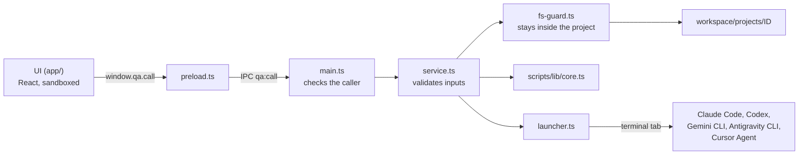

# Desktop app — architecture

The Moki desktop app is a thin visual layer over the framework. It has **no AI of its own**: it shows the project files, lets the QA read and edit them, and opens the AI tool the QA already uses with the request ready. Skills, workflows and project context stay plain files that any AI tool can use without the app.

## Pieces

| Path | Role |
|---|---|
| `scripts/qa.ts` | The `qa` command: opens the app (default), the terminal menu (`--terminal`) or prepares a request directly (`--project … --tool …`) |
| `desktop/main.ts` | Electron main process: one window, one validated IPC channel, project folder watcher |
| `desktop/preload.ts` | Bridge exposed to the UI as `window.qa` (`call`, `watch`, `onChanged`, `openLink`, `term`) |
| `desktop/service.ts` | Everything the UI can ask for: projects, file tree, read/write files, activity state, inbox, agent library and agents per project, linked folder, installed skills and agents, launching AI tools. Validates every input |
| `desktop/skill-registry.ts` | Searches the public SkillMD registry (api.skillmd.com) and installs a skill bundle, checking every file's sha256 and writing only inside the chosen skills folder |
| `desktop/fs-guard.ts` | Path confinement (`resolveInside`) and file type rules (editable, openable) |
| `desktop/pdfcraft.ts` | PDF comments and page edits through PdfCraft (`pdfcraft-cli run --script`): builds and checks the steps, runs them confined to the project folder |
| `desktop/launcher.ts` | Opens AI tools: terminal tools in a terminal tab of the app (or a new terminal window when node-pty is missing), editors with the request on the clipboard. Claude Code and Codex sessions get the app-only plugins in `adapters/app-plugins/` (ponytail, rtk; caveman and superpowers when the project turns them on in Settings → Skills → Plugins) |
| `desktop/terminals.ts` + `app/src/components/TerminalView.tsx` | Terminal tabs, as in Orca: a pseudo-terminal per tab (`node-pty`) in the main process, drawn with xterm.js. The "+" menu opens the user's shell or an AI tool (Claude Code, Codex, Gemini CLI, Antigravity CLI, Cursor Agent) in the framework root. The UI can only start commands the main process prepared, type into, resize and close them. Closing a tab, leaving the project or quitting the app (also by a signal) stops what runs in it |
| `desktop/run-tool.ts` | Runs in the terminal tab or new window (Windows): reads the request from a UTF-8 JSON file and starts the tool |
| `scripts/lib/core.ts` | Shared core (also used by the terminal menu): projects, runs, skills, request building |
| `scripts/lib/agents.ts` | Agent model shared with the validator and the build: parsing, validation, listing, duplication, Claude Code subagents ([agents.md](agents.md)) |
| `scripts/lib/docx.ts` | Word (`.docx`) to Markdown, so any AI can read stories written in Word |
| `scripts/lib/markdown.mjs` | Markdown to HTML (escapes all HTML from the document); also used for PDF reports |
| `app/` | UI (React + TypeScript, built by Vite into `app/dist/`): start screen, Obsidian-like workspace, launch dialog, agent library |
| `app/src/components/SkillsDialog.tsx` | "Skills & agents" (box in the ribbon): **Find skills** (SkillMD search by text or preset category, install for this project or for all projects), **Create agent** (`AgentForm.tsx`: a Claude Code subagent closed to the installed skills it may use; project agents may also use the usable Moki skills), **This repository** (`ProjectPanel.tsx`) and **Global** (`GlobalPanel.tsx`) |
| `app/src/components/ProjectPanel.tsx` | "This repository" tab ("This project" without a linked folder): the skills and agents installed only for this project — `<linked folder>/.claude/{skills,agents}`, or `workspace/projects/<id>/{skills,agents}` — to remove. Requests opened from the project name them |
| `app/src/components/GlobalPanel.tsx` + `GlobalDialog.tsx` | Skills (`~/.claude/skills`, `~/.agents/skills`) and agents (`~/.claude/agents`) installed for all projects, to open or remove; a skill leaves every global folder. Shown in the Global tab and, without opening a project, from **Skills & agents for all projects → Manage** on the start screen |
| `app/src/components/SetupDialog.tsx` | "Set up project": opens after creating a project or linking a folder, and from the side panel. The QA writes what the project is for and ticks global skills to use; `setupProject` in the service writes only `project.json` (`description`, `linkedSkills` — names of skills installed in `~/.claude/skills` or `~/.agents/skills`, nothing copied). Requests name each linked skill with its `SKILL.md` path; skills no longer installed are left out, and the Global tab shows which projects link each skill. "Find new skills" opens the registry search prefilled with the description. Optionally it then opens the "Prepare the project" activity (`setup`), where the AI proposes context changes in `proposed-updates.md` and waits for approval |



## Security model

- **Renderer locked down**: `contextIsolation`, `sandbox`, no Node integration, strict Content-Security-Policy, no navigation, no new windows (web links go to the default browser), all permission requests denied.
- **One IPC channel** (`qa:call`) that only accepts calls from the app's own page and only the service's method names.
- **Every input validated in the main process**: project ids must exist; paths are resolved inside the project folder (symlinks included); activities, tools and languages come from fixed lists; inbox files must exist.
- **Agents**: built-in agents are read-only; only the user's own agents (in `workspace/library/agents/`) can be saved or deleted, always resolved inside that folder and validated before saving. A launch with an agent requires it to be usable and enabled in the project.
- **Workspaces** (`desktop/workspaces.ts`, `app/src/screens/WorkspacePicker.tsx`): the app starts on a workspace picker, like Obsidian's vault switcher. `<root>/workspace` is the default workspace; others are folders with the same layout, under `<root>/workspaces/` or chosen by the user, listed in `<root>/workspaces/workspaces.json`. Selecting one points `workspaceDir()` (`scripts/lib/repo.mjs`) at it, and the app sets `QA_WORKSPACE` for the tools and helper commands it starts. Requests from another workspace name its folder. The switcher sits at the bottom of the start-screen list.
- **Tags and search** (`scripts/lib/core.ts`, `desktop/search.ts`, `app/src/components/TagPicker.tsx`, `SearchPanel.tsx`): tags on projects (`project.json`) and files (`<project>/tags.json`) share context between projects of the workspace; the launch dialog's context step lists it and the service recomputes it before building the request. The magnifier on the icon rail (Ctrl+Shift+F) searches project names and text files, filtered by tags.
- **My folder**: "Choose my folder" (welcome screen, side panel, link button in the ribbon) picks a folder in the native dialog. "Link an existing folder" on the start screen does the same before the project exists: the project is named after the folder (editable), created, linked and opened in "Set up". The UI only sends back the path of the folder last picked in the dialog (`pickFolder`); any other path is refused. Folders inside Moki and the user folder itself are refused. Linking marks that folder's `repositories[]` entry in `project.json` with `linkedFolder: true` and copies its AI settings (`.claude`, `.agents`, `.codex`, `.gemini`, `.cursor`, `CLAUDE.md`, `AGENTS.md`, `GEMINI.md`, skipping `node_modules` and `.claude/worktrees`) to `.moki-backup/link-<date>/` inside that folder and, when the folder has a `.git` directory, adds `.moki-backup/` to `.git/info/exclude` (local, unversioned); nothing else in the folder changes. Requests opened from the project name the linked folder.
- **Installed skills and agents**: names are only accepted from the service's own listings (`projectItems`, `globalItems`); removing moves to the system trash (`shell.trashItem`). Linking authorizes nothing: every install, agent or removal in a linked folder's `.claude` asks the user to confirm that action, backs up the current `.claude` to `backups/claude-<date>/` first, and is always refused when its `repositories[]` entry says `writeAllowed: false`. Registry skills are third-party content: the install confirmation shows the registry audit and each file is checked against its sha256.
- **Editing** only for existing `.md` and `.txt` files. **Opening with the default program** only for document and image types — never executables or scripts. **Open with** (the "…" next to it, Excel, Word and PDF files, `desktop/open-with.ts`): the programs come from the system (Linux: GIO; macOS: Launch Services; Windows: its own "Open with" dialog) and the one chosen must be among them when it is opened. "Always open … with the chosen program" is a preference of the app on this computer: Moki never changes the system's default program (the "Always" option of the Windows dialog is Windows' own).
- **PDF comments and page edits** (`desktop/pdfcraft.ts`, `app/src/components/PdfDoc.tsx`): the app never writes PDF bytes itself; PdfCraft (`pdfcraft-cli`, on PATH or in its install folder: on Windows beside `pdfcraft.exe`, which its MSI leaves off PATH; on macOS the CLI is a separate download from the DMG, looked up in `/opt/homebrew/bin`, `/usr/local/bin`, `~/.local/bin`, `~/bin`) does, with a fixed set of operations (comments: highlight by text or by a selection's quads, reply, edit, delete; pages: rotate, delete, move one page, insert a blank page; title and author). Only `.pdf` files inside the project, `--root` set to the project folder, every change checked in the main process, the steps passed in a temporary file (mode 600) removed right after, never through a shell. Files in `inbox/` are never changed, and page edits (which have no undo once saved) never save over any file: the first such change saves `<name>-edited.pdf` beside it, and later changes save that copy in place. Pages are drawn by pdf.js with its worker bundled into the page and started from a `blob:` URL (`worker-src blob:`; `connect-src` stays `'none'`); "Native viewer" switches back to Chromium's viewer, and the app falls back to it when pdf.js cannot open a file.
- **AI tools** are started from the fixed tool list. User text only travels as the prompt: on Windows through a UTF-8 file (never through a batch file); on macOS/Linux as a single-quoted argument.
- **Markdown** is rendered with all HTML escaped (including attribute quotes); links are handled by the app, not followed by the page.
- **VS Code extension** (`ide/vscode/`): the same UI in a webview with its own Content-Security-Policy (resources only from the extension's `dist/ui`), the same service through `callService`, the same note checks (`desktop/notes.ts`; only the main page opens notes), web links only `http(s)`, folders only from VS Code's dialog. AI tools open in VS Code terminals as `shellPath` plus `shellArgs`, never through a shell; on Windows through the same UTF-8 request file and `run-tool`.

## Build and run

```bash
npm run setup      # install + build (also after each git pull)
npm run app:build  # build only: Vite (UI) + esbuild (main, preload, run-tool) into app/dist and app/dist-electron
npm run app:dev    # build and open the app
qa                 # open the app (after npm link)
```

Both build folders are ignored by Git.

Development helpers (environment variables of the main process):

| Variable | Effect |
|---|---|
| `QA_OPEN_PROJECT=<id>` | Opens that project directly |
| `QA_OPEN_VIEW=library` / `launch` | Opens the agent library / the launch wizard (with `QA_OPEN_PROJECT`) |
| `QA_SCREENSHOT=<file.png>` | Saves a screenshot of the window and quits (visual checks) |
| `QA_ROOT=<folder>` | Uses that folder as the framework folder (the installed app defaults to Documents/Moki) |

## Installer

```bash
npm run dist:win     # release/Moki Setup <version>.exe (NSIS, per-user, desktop + Start-menu shortcuts)
npm run dist:mac     # .dmg (build on macOS)
npm run dist:linux   # .AppImage (build on Linux)
```

- The build stages only the built app and a minimal `package.json` in `build/app` (electron-builder two-package layout); `release/` and `build/` are ignored by Git.
- The installer also carries the framework files (`extraResources` → `resources/framework`). On first launch, `desktop/boot.ts` copies them to **Documents/Moki** (or `QA_ROOT`) and points the app there; each new build refreshes the framework files once (`build-info.json` id) and never touches `workspace/` (`desktop/framework.ts`).
- `node-pty` is an optional dependency (N-API, no rebuild for Electron): prebuilt for Windows/macOS, compiled by `npm install` on Linux, which needs a C++ compiler (Fedora: `gcc-c++`, Ubuntu: `build-essential`). Without it the build warns and the app opens AI tools in external terminal windows. It is unpacked from `app.asar`.
- `run-tool.mjs` is unpacked from `app.asar` and run by the app's own executable in Node mode, so AI tools can be opened on computers without Node.js.
- Not code-signed yet: Windows SmartScreen shows a warning on first run.
- `npm audit` reports a moderate issue in `sprintf-js`, a build-time dependency of electron-builder; it is not shipped inside the app.

## Tests

`tests/desktop.test.ts` exercises the service without Electron: project creation, file tree, reading and editing, path confinement, launch validation, agent library and agents per project, Word extraction, Markdown escaping and the launcher's quoting. AI tools are never started in tests.

## Planned

- Code signing for the installer, and automatic updates.
- Approvals and context proposals as buttons in the side panel.
