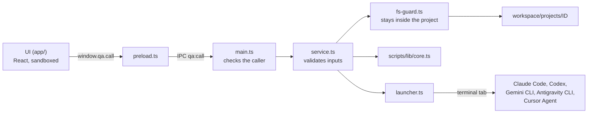

# Desktop app — architecture

The Moki desktop app is a thin visual layer over the framework. It has **no AI of its own**: it shows the project files, lets the QA read and edit them, and opens the AI tool the QA already uses with the request ready. Skills, workflows and project context stay plain files that any AI tool can use without the app.

## Pieces

| Path | Role |
|---|---|
| `scripts/qa.ts` | The `qa` command: opens the app (default), the terminal menu (`--terminal`) or prepares a request directly (`--project … --tool …`) |
| `desktop/main.ts` | Electron main process: one window, one validated IPC channel, project folder watcher |
| `desktop/preload.ts` | Bridge exposed to the UI as `window.qa` (`call`, `watch`, `onChanged`, `openLink`, `term`) |
| `desktop/service.ts` | Everything the UI can ask for: projects, file tree, read/write files, activity state, inbox, agent library and agents per project, linked folder, installed skills and agents, launching AI tools. Validates every input |
| `desktop/skill-registry.ts` | Searches the public SkillMD registry (api.skillmd.com) and installs a skill bundle, checking every file's sha256 and writing only inside the chosen skills folder |
| `desktop/craft-download.ts` | Downloads an ArtCraft Launcher app (fixed list `CRAFT_APPS` in `scripts/lib/core.ts`) from its GitHub release and checks its SHA-256; it never installs or runs the file. The "+" menu › *Download ArtCraft apps…* opens the list |
| `desktop/editor-extension.ts` | Settings › My AIs: each AI tool's version (`--version`), the Moki extension installed in VS Code or Cursor (`--list-extensions`) and installing it (`--install-extension`) from `release/moki-<version>.vsix` in a checkout, or else from the Moki release of the app's version, only when GitHub vouches for its SHA-256 (`releaseByTag`, `checksum` and `download` of `craft-download.ts`). Commands come from `TOOLS`; arguments are fixed or a path Moki made |
| `desktop/claude-import.ts` | Reads an uploaded `.claude` folder, `skills/` or `agents/` folder, single skill or `.zip` of those and checks every item (valid name, `SKILL.md` and description, no secret, not a Moki name); limits 1000 files, 5 MB per file, 50 MB total; symbolic links are not followed; `settings.json`, `hooks/`, `commands/`, `CLAUDE.md` and `.mcp.json` are listed and never imported. It writes nothing: `claudeUploadPick` / `claudeUploadPreview` in the service only read, `claudeUploadApply` writes after the user marks items and confirms (items already installed are never replaced; a linked folder's `.claude` is backed up first; a failure removes what was created) |
| `desktop/fs-guard.ts` | Path confinement (`resolveInside`) and file type rules (editable, openable) |
| `desktop/pdfcraft.ts` | PDF comments and page edits through PdfCraft (`pdfcraft-cli run --script`): builds and checks the steps, runs them confined to the project folder |
| `desktop/launcher.ts` | Opens AI tools: terminal tools in a terminal tab of the app (or a new terminal window when node-pty is missing), editors with the request on the clipboard. Claude Code and Codex sessions get the app-only plugins in `adapters/app-plugins/` (ponytail, rtk; caveman and superpowers when the project turns them on in Settings → Skills → Plugins) |
| `desktop/terminals.ts` + `app/src/components/TerminalView.tsx` | Terminal tabs, as in Orca: a pseudo-terminal per tab (`node-pty`) in the main process, drawn with xterm.js. The "+" menu opens the user's shell or an AI tool (Claude Code, Codex, Gemini CLI, Antigravity CLI, Cursor Agent) in the framework root. The UI can only start commands the main process prepared, type into, resize and close them. Leaving the project does not stop a terminal: it keeps running in the main process, which keeps the end of its output (256 KB), and its tab comes back with that output when the project opens again. Closing its tab or quitting the app (also by a signal) stops it. When a terminal that ran a step of an operation ends, the main process tells the run, whatever is on screen |
| `desktop/run-tool.ts` | Runs in the terminal tab or new window (Windows): reads the request from a UTF-8 JSON file and starts the tool |
| `scripts/lib/core.ts` | Shared core (also used by the terminal menu): projects, runs, skills, request building |
| `scripts/lib/agents.ts` | Agent model shared with the validator and the build: parsing, validation, listing, duplication, Claude Code subagents ([agents.md](agents.md)) |
| `scripts/lib/docx.ts` | Word (`.docx`) to Markdown, so any AI can read stories written in Word |
| `scripts/lib/markdown.mjs` | Markdown to HTML (escapes all HTML from the document); also used for PDF reports |
| `app/` | UI (React + TypeScript, built by Vite into `app/dist/`): start screen, Obsidian-like workspace, launch dialog, agent library |
| `app/src/components/SkillsDialog.tsx` | "Skills & agents" (box in the ribbon): **Find skills** (SkillMD search by text or preset category, install for this project or for all projects), **Upload** (`ClaudeUpload.tsx`, also in Set up project and in Settings › Skills › Add a skill, which on the start screen without a project is the only way to add and installs for all projects), **Create agent** (`AgentForm.tsx`: a Claude Code subagent closed to the installed skills it may use; project agents may also use the usable Moki skills), **This repository** (`ProjectPanel.tsx`) and **Global** (`GlobalPanel.tsx`) |
| `app/src/components/ProjectPanel.tsx` | "This repository" tab ("This project" without a linked folder): the skills and agents installed only for this project — `<linked folder>/.claude/{skills,agents}`, or `workspace/projects/<id>/{skills,agents}` — to remove. Requests opened from the project name them |
| `app/src/components/GlobalPanel.tsx` + `GlobalDialog.tsx` | Skills (`~/.claude/skills`, `~/.agents/skills`) and agents (`~/.claude/agents`) installed for all projects, to open or remove; a skill leaves every global folder. Shown in the Global tab and, without opening a project, from **Skills & agents for all projects → Manage** on the start screen |
| `app/src/components/SetupDialog.tsx` | "Set up project": opens after creating a project or linking a folder, or to review a proposed plan. The QA writes what the project is for and ticks global skills to use; `setupProject` in the service writes only `project.json` (`description`, `linkedSkills` — names of skills installed in `~/.claude/skills` or `~/.agents/skills`, nothing copied). Requests name each linked skill with its `SKILL.md` path; skills no longer installed are left out, and the Global tab shows which projects link each skill. "Find new skills" opens the registry search prefilled with the description. Optionally it then opens the "Prepare the project" activity (`setup`), where the AI proposes context changes in `proposed-updates.md` and waits for approval. The project panel independently edits the name or description without changing its id, linked skills or other settings. |
| `app/src/components/AiToolsPage.tsx` | Settings › My AIs: the terminal and editor AI tools with path, version and the Moki extension, one row each: the main action as an icon, the others in its **…** menu; **Make default** (`prefs.ts` `qa-tool`, where the side panel, notes, the wizard, operations and skill forms start; choosing another AI there does not change it); **Install** a missing terminal AI through a terminal tab (`run-tool.ts` asks `y` first); **Download** a missing editor; **Install the Moki extension and open**. The tool catalog (`ToolCatalog.tsx`) sends an AI not found here to this tab |



## Security model

- **Renderer locked down**: `contextIsolation`, `sandbox`, no Node integration, strict Content-Security-Policy, no navigation, no new windows (web links go to the default browser), all permission requests denied.
- **One IPC channel** (`qa:call`) that only accepts calls from the app's own page and only the service's method names.
- **Every input validated in the main process**: project ids must exist; paths are resolved inside the project folder (symlinks included); activities, tools and languages come from fixed lists; inbox files must exist.
- **Agents**: built-in agents are read-only; only the user's own agents (in `workspace/library/agents/`) can be saved or deleted, always resolved inside that folder and validated before saving. A launch with an agent requires it to be usable and enabled in the project.
- **Workspaces** (`desktop/workspaces.ts`, `app/src/screens/WorkspacePicker.tsx`): the app starts on a workspace picker, like Obsidian's vault switcher. `<root>/workspace` is the default workspace; others are folders with the same layout, under `<root>/workspaces/` or chosen by the user, listed in `<root>/workspaces/workspaces.json`. Selecting one points `workspaceDir()` (`scripts/lib/repo.mjs`) at it, and the app sets `QA_WORKSPACE` for the tools and helper commands it starts. Requests from another workspace name its folder. The switcher stays at the bottom of the start-screen sidebar. Creating a workspace and opening a folder as one stay on the picker only while the built-in workspace is the only one; after another exists, those two actions are on Manage workspaces, and the picker keeps the list.
- **Tags and search** (`scripts/lib/core.ts`, `desktop/search.ts`, `app/src/components/TagPicker.tsx`, `SearchPanel.tsx`): tags on projects (`project.json`) and files (`<project>/tags.json`) share context between projects of the workspace; the launch dialog's context step lists it and the service recomputes it before building the request. The magnifier on the icon rail (Ctrl+Shift+F) searches project names and text files, filtered by tags.
- **My folder**: "Choose my folder" (welcome screen, the link button in the ribbon) picks a folder in the native dialog. "Open a project" on the start screen does it before the project exists: `pickFolder` returns the project already linked to the chosen folder (it just opens) or the folder and a suggested name; the user names the project and `createProject` (starter `minimal`) links it. The UI only sends back the path of the folder last picked in the dialog; any other path is refused. In the tree the linked folder is the node `@folder` (live, `TreeNode.linked` = its path): every file call resolves `@folder/…` inside that folder (`projectPath`, confined by `resolveInside`), the main process watches it too (ignoring `node_modules`, `.git` and build folders), file tags stay for the project's own files, and `openInEditor` opens it in an installed editor tool (VS Code, Cursor). Folders inside Moki and the user folder itself are refused. Linking marks that folder's `repositories[]` entry in `project.json` with `linkedFolder: true` and copies its AI settings (`.claude`, `.agents`, `.codex`, `.gemini`, `.cursor`, `CLAUDE.md`, `AGENTS.md`, `GEMINI.md`, skipping `node_modules` and `.claude/worktrees`) to `.moki-backup/link-<date>/` inside that folder and, when the folder has a `.git` directory, adds `.moki-backup/` to `.git/info/exclude` (local, unversioned); nothing else in the folder changes. Requests opened from the project name the linked folder.
- **Installed skills and agents**: names are only accepted from the service's own listings (`projectItems`, `globalItems`); removing moves to the system trash (`shell.trashItem`). Linking authorizes nothing: every install, agent or removal in a linked folder's `.claude` asks the user to confirm that action, backs up the current `.claude` to `backups/claude-<date>/` first, and is always refused when its `repositories[]` entry says `writeAllowed: false`. Registry skills are third-party content: the install confirmation shows the registry audit and each file is checked against its sha256.
- **Editing** only for existing `.md` and `.txt` files. **Opening with the default program** only for document and image types — never executables or scripts. **Open with** (the "…" next to it, Excel, Word and PDF files, `desktop/open-with.ts`): the programs come from the system (Linux: GIO; macOS: Launch Services; Windows: its own "Open with" dialog) and the one chosen must be among them when it is opened. "Always open … with the chosen program" is a preference of the app on this computer: Moki never changes the system's default program (the "Always" option of the Windows dialog is Windows' own).
- **PDF comments and page edits** (`desktop/pdfcraft.ts`, `app/src/components/PdfDoc.tsx`): the app never writes PDF bytes itself; PdfCraft (`pdfcraft-cli`, on PATH or in its install folder: on Windows beside `pdfcraft.exe`, which its MSI leaves off PATH; on macOS the CLI is a separate download from the DMG, looked up in `/opt/homebrew/bin`, `/usr/local/bin`, `~/.local/bin`, `~/bin`) does, with a fixed set of operations (comments: highlight by text or by a selection's quads, reply, edit, delete; pages: rotate, delete, move one page, insert a blank page; title and author). Only `.pdf` files inside the project, `--root` set to the project folder, every change checked in the main process, the steps passed in a temporary file (mode 600) removed right after, never through a shell. Files in `inbox/` are never changed, and page edits (which have no undo once saved) never save over any file: the first such change saves `<name>-edited.pdf` beside it, and later changes save that copy in place. Pages are drawn by pdf.js with its worker bundled into the page and started from a `blob:` URL (`worker-src blob:`; `connect-src` stays `'none'`); "Native viewer" switches back to Chromium's viewer, and the app falls back to it when pdf.js cannot open a file.
- **Notes between PDF pages** (`desktop/pdf-notes.ts`, `app/src/components/PdfDoc.tsx`): the page toolbar adds a new note directly, and an existing note can be dragged between pages. Cards have editable titles, resizable height, selectable border colors, and the normal note editor with collapsible tools. The project-local `.moki-pdf-notes.json` stores links, page positions, card heights and border colors; `.moki-note-titles.json` stores display titles without renaming note files or breaking their links. These do not modify the PDF, and other PDF viewers do not show the notes. Page edits made in Moki carry the links to edited copies and update their positions; if a page is deleted, its notes follow the preceding surviving page (or the beginning). Changes made to the PDF outside Moki cannot be tracked. Loose notes remain on this computer, even if linked from a project. Removing a link does not delete the note. Concurrent note edits are checked before saving to prevent silent overwrites.
- **AI tools** are started from the fixed tool list. User text only travels as the prompt: on Windows through a UTF-8 file (never through a batch file); on macOS/Linux as a single-quoted argument.
- **The assistant card** of the project panel has no title: its tabs are its header, and each one is a start that stops at its own depth. **Agent** (call an agent) takes only an agent (required) and an AI, and opens a conversation (a terminal tab in Moki for a terminal AI; an editor AI opens the editor and copies the request): no activity, files or notes. **Activity** searches the activity list and picks one (what the activity defines arrives filled, such as the agent of an activity that points to one), then the optional agent (or none, the skill decides) and the AI; inbox files, shared context and a note come in a dialog only when the activity needs files, and an activity of an operation opens that operation's start. **Operation** searches every operation on this computer and opens its start screen in the main area, where each step arrives with its agent and AI from the operation and the AI of each step (or one AI for all) is changed with the same AI picker; the agents of an operation come from the operation itself and are not changed here. The pickers are shared: `AgentCatalog.tsx` (`AgentPick`), `ToolCatalog.tsx` (`AiPick`, only the AIs found on this computer), `ActivityCatalog.tsx` and `OperationCatalog.tsx`, all in the `CatalogModal.tsx` frame with a search.
- **Executions** in the project panel separates activities from operations (its tabs are its header, with no title; Under way and Finished are separate buttons, the same on activities and operations; an operation is chosen on the assistant card) and lists all finished runs, as well as those under way. The file tree calls the existing `runs/` folder "Execution files"; neither the folder nor its contents are moved. Activity launch requests are kept in local UI preferences per workspace and project, distinct from actual runs. The request asks the AI to use a unique slug if it creates a run; only an exact matching run replaces the waiting request. If the tool merely prepares a prompt or the AI does not use that slug, the request remains separate: Moki never invents a run or its status. Removing a request from the list does not delete project files.
- **Markdown** is rendered with all HTML escaped (including attribute quotes); links are handled by the app, not followed by the page. A `mermaid` or `excalidraw` fence is drawn in the app after that (Mermaid with `securityLevel: 'strict'` and no HTML labels; Excalidraw only from a scene whose `type` is `excalidraw`). The `/` menu inserts either fence, in the formatted editor and in the Markdown source. A drawing can be edited and is saved back into the same fence; Mermaid stays source. Visual editing keeps a diagram as one card, with an editable paragraph before and after it, so Enter and typing there stay in the text. In the plain source editor the same fence is one closed line (Drawing or Diagram): the text around it stays a normal field, the edit icon opens an Excalidraw scene that fills the window, and Code shows the fence when it is needed. A drawn diagram fits the width of its card, and the same zoom as a PDF (50% to 300%) applies to a drawing and to a Mermaid diagram. Exporting a note to PDF asks the same local Edge/Chrome/Chromium to draw each diagram and embeds one PNG of the whole drawing; a diagram that cannot be drawn stays as its code block. The installed framework carries the drawing bundle from `app:build` (`scripts/lib/diagram-frame.iife.js`, not versioned); a checkout without that file builds it with esbuild, and a PDF with no diagram never loads it. The page's content security policy is unchanged. Visual editing maps supported rendered text back to the original source, preserving unchanged spacing and line endings even when headings and lists are adjacent. A note's formatted view uses that same editor, so it can be typed in; a note whose formatting cannot round-trip stays as a reading view and asks for the source. On the start screen, Pinned, Projects, Favorites and Loose notes keep their headings in place, and each list scrolls on its own. A heading collapses its list; dragging the line between two open lists changes their height, and a double click on that line shares the height equally again. The choice is remembered on this computer. Unsupported formatting uses the source editor, and changes that would remove comment marks are refused with a notice. Comments and their optional palette colors are stored in an HTML comment block in the Markdown file, so other Markdown viewers hide them; older comments keep the theme color until changed.
- **Run details** for an activity open in the main area, in the same place as an operation run, and the project panel stays on the right. The view shows status, the current step, completed steps, approvals and file paths, and can continue the activity in the AI tool. Opening an operation file still offers **Open operation** in the side panel; choosing an operation from Execuções opens its run in the main area.
- **Exporting a note** (`exportNote` in `desktop/service.ts`, menu in `app/src/components/NoteDialog.tsx`): through the same `qa:call` channel, with no new IPC. Only `notes/<file>.md` of a listed project; the destination comes from a native save dialog opened by the main process (`saveFile` in `desktop/main.ts`), never from the page, so it is the one place the app writes outside the workspace, and only where the person chose. Markdown and text are written directly; the PDF runs `scripts/pdf.mjs` (shipped in `framework/scripts`) as a child process with `execFile` (Electron as Node, no shell) in a temporary folder removed afterwards, with the project's document template as `--style`; with no Edge/Chrome/Chromium the error says so. Nothing is written into `notes/`.
- **Downloading ArtCraft apps** (`desktop/craft-download.ts`, `app/src/components/CraftDownloads.tsx`): only the fixed `CRAFT_APPS` list (repository `storytold/<id>`); the files offered are chosen from the latest release by exact name for this system and its package family (Windows: `.msi`, portable `.zip`; macOS: `.dmg`; Linux: `.rpm` for Fedora/RHEL/SUSE or `.deb` for Debian/Ubuntu by `ID`/`ID_LIKE` in os-release, then AppImage and `.tar.gz`; unknown distro: only AppImage and `.tar.gz`), the recommended one first; the person picks one, and the main process accepts only a name from the list it recomputes (the UI cannot ask for a `.deb` on Fedora), its name must be plain (letters, digits, `.`, `_`, `-`) and the URL is built by Moki, never copied from the release data. A SHA-256 from GitHub or the release's `SHA256SUMS.txt` is mandatory (without one nothing is downloaded); the file is written as `.part` while hashed (1 GiB limit) and kept only if the hash matches. The destination comes from the system save dialog, never from the UI. Moki never installs or runs the file; it shows the folder.
- **IDE Companion** (`ide/vscode/`, `ide/mcp/`): no desktop UI and no write tools. Everything goes through `desktop/companion.ts`, opened for one project: file ids are checked against that project's own context and notes or the context shared with it by tags, paths are resolved with `resolveInside`, secret-looking files are never listed or read, and `ask`/`manual` resources need the person's selection. The MCP server is fixed to its project when it starts.

## Build and run

```bash
npm run setup      # install + build (also after each git pull)
npm run app:build  # build only: Vite (UI) + esbuild (main, preload, run-tool) into app/dist and app/dist-electron
npm run app:dev    # build and open the app
qa                 # open the app (after npm link)
```

Both build folders are ignored by Git.

Development helpers (environment variables of the main process):

| Variable | Effect |
|---|---|
| `QA_OPEN_PROJECT=<id>` | Opens that project directly |
| `QA_OPEN_VIEW=library` / `launch` | Opens the agent library / the launch wizard (with `QA_OPEN_PROJECT`) |
| `QA_SCREENSHOT=<file.png>` | Saves a screenshot of the window and quits (visual checks) |
| `QA_ROOT=<folder>` | Uses that folder as the framework folder (the installed app defaults to Documents/Moki) |

## Installer

```bash
npm run dist:win     # release/Moki Setup <version>.exe (NSIS, per-user, desktop + Start-menu shortcuts)
npm run dist:mac     # .dmg (build on macOS)
npm run dist:linux   # .AppImage (build on Linux)
```

- The build stages only the built app and a minimal `package.json` in `build/app` (electron-builder two-package layout); `release/` and `build/` are ignored by Git.
- The installer also carries the framework files (`extraResources` → `resources/framework`). On first launch, `desktop/boot.ts` copies them to **Documents/Moki** (or `QA_ROOT`) and points the app there; each new build refreshes the framework files once (`build-info.json` id) and never touches `workspace/` (`desktop/framework.ts`).
- `node-pty` is an optional dependency (N-API, no rebuild for Electron): prebuilt for Windows/macOS, compiled by `npm install` on Linux, which needs a C++ compiler (Fedora: `gcc-c++`, Ubuntu: `build-essential`). Without it the build warns and the app opens AI tools in external terminal windows. It is unpacked from `app.asar`.
- `run-tool.mjs` is unpacked from `app.asar` and run by the app's own executable in Node mode, so AI tools can be opened on computers without Node.js.
- Not code-signed yet: Windows SmartScreen shows a warning on first run.
- `npm audit` reports a moderate issue in `sprintf-js`, a build-time dependency of electron-builder; it is not shipped inside the app.

## Tests

`tests/desktop.test.ts` exercises the service without Electron: project creation, file tree, reading and editing, path confinement, launch validation, agent library and agents per project, Word extraction, Markdown escaping and the launcher's quoting. AI tools are never started in tests.

## Planned

- Code signing for the installer, and automatic updates.
- Approvals and context proposals as buttons in the side panel.
